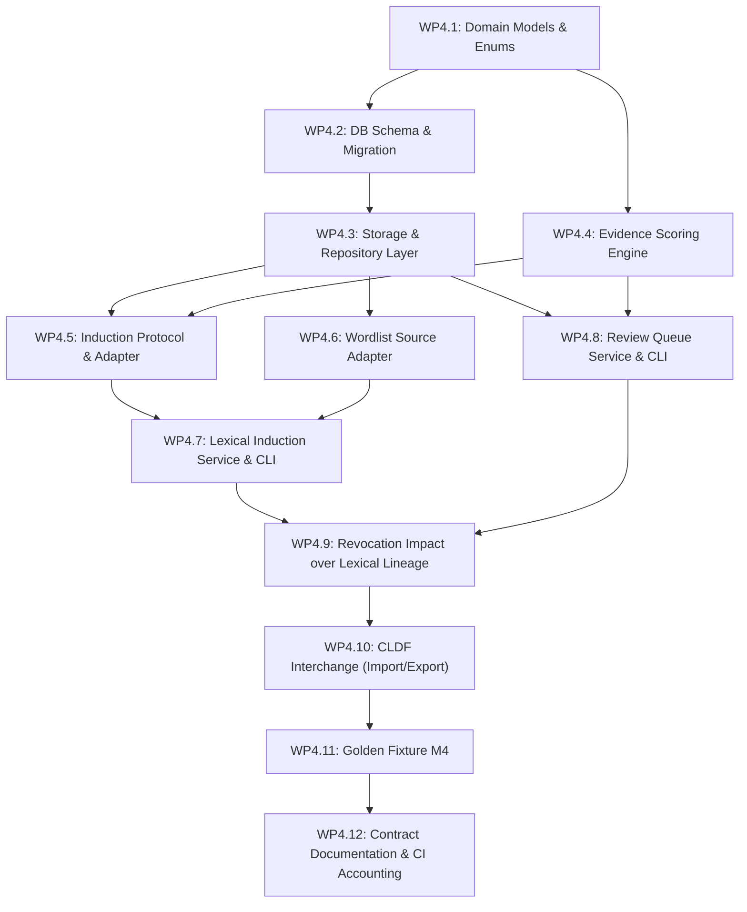

# M4 Lexical Evidence Implementation Plan

> **Superseded policy note (ADR-0025).** Any rule below that blocks processing or
> training because of a source's classification, licence, rights holder, or register is
> historical. Presence in the repository authorizes processing and training; licences
> and ownership are records, not gates.

> For agentic workers: execute work packages task-by-task using the executing-plans skill;
> senior review gates each package. No implementation is authorized by this document alone.

**Status:** Completed — 2026-10-16 (WP4.1–WP4.12; Gates 17–28). Owner ratification pending.
**Date:** 2026-10-15  
**Goal:** Persist auditable lexical evidence (`Lexeme`, `Sense`, `Concept`), enrich `EvidenceItem` with versioned scoring and independence tracking, implement candidate induction from token alignment and wordlists, provide an immutable human review queue with role-based authority, and deliver governed CLDF interchange.  
**Architecture:** Relational lexical and review models sit on top of the PostgreSQL canonical store with append-only integrity. Pure protocols decouple scoring, induction, review, and CLDF adapters from storage. Source governance is strictly enforced: machine confidence never validates hypotheses, contact language translations are treated strictly as meaning hypotheses, and `distill_only` source text never enters exports.  
**Tech stack:** Python 3.12+, uv, Pydantic v2, SQLAlchemy 2, Alembic, PostgreSQL 16+, Typer, pycldf, pytest/Hypothesis, Ruff/mypy.

---

## 1. Baseline and scope

Milestone 3 delivered complete segment and token alignment models, services, reports, benchmark harness, and golden fixture coverage (`78a1b8f`), with 1,383 passing compiler-free CI tests. The dual-source realdata ScriptureEarth gate remains cleanly unsatisfied on `tsk` task 175 pending external operator inputs and ADR-0012 acceptance.

Milestone 4 is strictly defined by `docs/DEVELOPMENT.md:75`:
> **M4 — Lexical evidence**: Deliver Lexeme/Sense/Concept, EvidenceItem enrichment, lexical candidate induction interface, CLDF import/export and lexical review queue.

### Scope fences

- **No morphology or paradigms in M4**: Although `docs/DOMAIN-MODEL.md` connects `Paradigm` and feature bundles to lexemes, morphology induction and paradigm modeling belong exclusively to Milestone 5. `Lexeme` in M4 MUST NOT contain paradigm references, slot definitions, or inflectional feature bundles (ADR-0013).
- **Sub-token vs. whole-token**: Lexical induction in M4 operates on whole `TokenOccurrence`s and wordlist entries. Analyzing sub-token affixes (e.g. `-ra` in `wesa-ra`) is deferred to M5.
- **Review queue domain scope**: `ReviewTaskType` supports all types defined in `docs/REVIEW-WORKFLOW.md`, but M4 services and CLI reject non-lexical task types (e.g. morphology segmentation, grammar construction).
- **No synthetic generation or model training**: Consuming lexical knowledge for language models is strictly out of scope per `DEVELOPMENT.md`.

---

## 2. Conflicts and gaps (C1–C11)

| ID | Evidence / gap | Resolution / owner |
|---|---|---|
| C1 | `DOMAIN-MODEL.md` allows one Form to link to multiple Lexemes, but no relational join model exists | Introduce explicit `form_lexeme` relational join table supporting many-to-many multiplicity (ADR-0013 / WP4.1) |
| C2 | `Concept` has unspecified schema and external mapping semantics | Define `Concept` with `concept_type="local"` by default and optional external mapping (e.g. Concepticon ID) (WP4.1) |
| C3 | `REVIEW-WORKFLOW.md` specifies reviewer roles but provides no storage or configuration mechanism | Implement `ReviewAuthorityRegistry` in language profile config as the smallest reversible abstraction, avoiding premature RBAC database tables (ADR-0013 / WP4.8) |
| C4 | Automated induction could improperly promote hypotheses to validated status | Invariant 3 enforced: scoring policies promote `candidate` → `supported` only; `validated` requires authorized `ReviewDecision` (WP4.4, WP4.8) |
| C5 | Related/contact-language (Portuguese) glosses might be treated as target-language lexical forms | Invariants 8 & 9 enforced: Portuguese glosses/senses are hypotheses about meaning attached to `Sense`, never target-language `Lexeme` forms (WP4.1, WP4.5) |
| C6 | Existing `03-wordlist` fixture in golden fixture was marked malformed for M2 sentence extraction | Implement dedicated `WordlistAdapter` under governed raw ingestion to extract dictionary entries into `dictionary_assertion` EvidenceItems (WP4.6) |
| C7 | CLDF dependency and format boundary unspecified | Adopt `pycldf` for standard CLDF Wordlist/Dictionary reading and writing under ADR-0003 (WP4.10) |
| C8 | Downstream CLDF exports might inadvertently leak `distill_only` source prose | Implement strict governance filter: exports only allow `validated` (or `supported` with explicit flag); raw sentences/prose from `distill_only` sources are strictly barred from export (WP4.10) |
| C9 | Revocation of an ancestor source (e.g. parallel corpus) must invalidate downstream lexical candidates | Extend transitive lineage impact query to traverse alignment edge → lexical candidate → review decision → export (WP4.9) |
| C10 | State transitions in human review require dependent invalidation | Recompute target score and flag directly dependent records as stale on review decision; link TODO to `REVIEW-WORKFLOW.md` §State transition for full cascading recalculation (WP4.8) |
| C11 | Opaque IDs vs reproducible runs | Follow M1–M3 pattern: ULID-prefixed IDs (`lex_`, `sense_`, `cpt_`, `rev_task_`, `rev_dec_`), idempotent run reuse via parameter/input hashing, and label normalization in golden snapshots (WP4.1, WP4.3, WP4.11) |

---

## 3. Global constraints and execution gates

1. **Raw sources, segments, tokens, and alignment edges are immutable.**
2. **Observation and inference are different entities**: Lexemes and Senses are hypotheses; aligners and wordlists produce evidence only.
3. **Machine confidence never silently promotes to `validated`.** Only an authorized `ReviewDecision` produces `validated` or `rejected`.
4. **Lineage is preserved relationally**: Every candidate Lexeme and Sense links via `derived_from` to its producing `ProcessingRun` and supporting `EvidenceItem`s.
5. **`distill_only` source text MUST NOT enter exports directly.**
6. **No third-party API exposure**: Restricted material never leaves local execution.
7. **Compiler-free CI baseline**: `scripts/ci.sh` must remain completely green with zero skips.
8. **Sequential database testing**: All PostgreSQL migration and service runs must be strictly sequential.
9. **Two-family review gate**: Every work package must be reviewed and approved by Senior Reviewer (`gpt-6.1-sol` or Opus 5.5) before committing.

---

## 4. Target architecture and data flow

```text
M3 TokenAlignmentEdges / Governed Wordlists / IGT Observations
  -> EvidenceItem Enrichment (kind, polarity, strength breakdown, independence_group)
  -> LexicalInducer Protocol [Operation.DISTILL_LEXICON]
       -> candidate Lexemes + Senses + Concept mappings
       -> form_lexeme relational links (ambiguity preserved)
       -> derived_from lineage to alignment edges and run
  -> LexicalScorePolicy [policy_version="lexical-v1"]
       -> score breakdown aggregation -> candidate -> supported (if threshold met)
  -> ReviewService [Operation.HUMAN_REVIEW; ReviewAuthorityRegistry]
       -> ReviewTask (priority = frequency * uncertainty * impact * conflict * sensitivity)
       -> ReviewDecision (accept, reject, modify, uncertain, defer)
       -> state transition to validated / rejected (authorized reviewer required)
  -> LineageRevocationService
       -> transitive impact query over lexical graph
  -> CLDF Interchange (pycldf) [ADR-0003]
       -> Import: registered source -> raw store -> lexical candidate observations
       -> Export: governance filter (validated/supported only; distill_only prose excluded)
```

---

## 5. Work package overview and dependency order



---

## 6. Detailed work packages

### WP4.1 — Domain Models & Enums

**Depends:** None. **Size:** one session.  
**Own:** `src/langpipe/domain/models/lexical.py`, `src/langpipe/domain/models/review.py`, modify `src/langpipe/domain/enums.py`, `src/langpipe/domain/ids.py`, `src/langpipe/domain/models/__init__.py`.  
**Produces:** Pure Pydantic models for Lexeme, Sense, Concept, FormLexemeLink, ReviewTask, ReviewDecision, LexicalScoreBreakdown.

- [x] Add `IdPrefix.CONCEPT = "cpt"`, `IdPrefix.REVIEW_TASK = "rtask"`, `IdPrefix.REVIEW_DECISION = "rdec"`.
- [x] Add `EntityType.LEXEME`, `EntityType.SENSE`, `EntityType.CONCEPT`, `EntityType.FORM_LEXEME`, `EntityType.REVIEW_TASK`, `EntityType.REVIEW_DECISION`.
- [x] Add `ReviewTaskType` (`lexical_sense`, `lemma`, `morphology_segmentation`, `morpheme_function`, `grammar_construction`, `register_domain`, `alignment_spotcheck`, `governance_export`, `pronunciation`).
- [x] Add `ReviewDecisionKind` (`accept`, `reject`, `modify`, `uncertain`, `defer`).
- [x] Implement `Concept`: `id`, `concept_type` (default `"local"`), `canonical_label`, optional `concepticon_id`, optional `external_urn`, `run_id`, `created_at`.
- [x] Implement `Lexeme`: `id`, `language`, optional `lemma_form_id`, optional `pos`, `status` (`LifecycleStatus`), `register` / `domain` tags, `run_id`, `created_at`. Strictly NO paradigms or morphological feature bundles.
- [x] Implement `FormLexemeLink`: `id`, `form_id`, `lexeme_id`, optional `role` (e.g. `"primary_lemma"`, `"variant"`), `run_id`, `created_at`.
- [x] Implement `Sense`: `id`, `lexeme_id`, `glosses` (dict mapping language tag to list of gloss strings), optional `concept_id`, `status` (`LifecycleStatus`), `domain` / `register` tags, `run_id`, `created_at`.
- [x] Implement `ReviewTask`: `id`, `task_type` (`ReviewTaskType`), `target_id`, `target_version`, `evidence_item_ids` (list of IDs), `required_role`, `priority` (float), `reason`, `creator_run_id`, `status` (`LifecycleStatus` or task status), `created_at`.
- [x] Implement `ReviewDecision`: `id`, `task_id`, `target_id`, `decision` (`ReviewDecisionKind`), `reviewer_id`, `reviewer_role`, optional `superseding_object_id`, optional `notes`, `created_at`. Decisions are immutable.
- [x] Implement `LexicalScoreBreakdown`: `policy_version`, `overall`, `components` (dict of floats), `penalties` (dict of floats), `independence_groups` (list of strings).
- [x] Acceptance: Unit tests covering instantiation, validation, immutability, serialization roundtrips.

> Landed annotation: `ReviewTask.status` is an operational task-workflow status
> (`open`/`in_review`/`resolved`/`cancelled`), never a `LifecycleStatus` — see §9 drift.

### WP4.2 — Database Schema & Alembic Migration

**Depends:** WP4.1. **Size:** one session.  
**Own:** `alembic/versions/0004_lexical_and_review.py`, modify `src/langpipe/storage/schema.py`, `tests/integration/test_migrations.py`.  
**Produces:** Alembic migration creating tables `concepts`, `lexemes`, `form_lexemes`, `senses`, `review_tasks`, `review_decisions`, indexes, foreign keys, and append-only triggers.

- [x] Write migration `0004_lexical_and_review.py` defining:
  - `concepts`: `id` PK, `concept_type`, `canonical_label`, `concepticon_id`, `external_urn`, `run_id` FK, `created_at`.
  - `lexemes`: `id` PK, `language`, `lemma_form_id` FK nullable, `pos`, `status`, `register`, `domain`, `score_breakdown` JSONB, `run_id` FK, `created_at`.
  - `form_lexemes`: `id` PK, `form_id` FK, `lexeme_id` FK, `role`, `run_id` FK, `created_at`, unique constraint `(form_id, lexeme_id)`.
  - `senses`: `id` PK, `lexeme_id` FK, `glosses` JSONB, `concept_id` FK nullable, `status`, `domain`, `register`, `score_breakdown` JSONB, `run_id` FK, `created_at`.
  - `review_tasks`: `id` PK, `task_type`, `target_id`, `target_version`, `evidence_item_ids` JSONB, `required_role`, `priority`, `reason`, `creator_run_id` FK, `status`, `created_at`.
  - `review_decisions`: `id` PK, `task_id` FK, `target_id`, `decision`, `reviewer_id`, `reviewer_role`, `superseding_object_id` nullable, `notes` nullable, `created_at`.
- [x] Add append-only immutability triggers for `review_decisions` and `form_lexemes`.
- [x] Add forward and backward migration tests in `test_migrations.py` with PostgreSQL, proving schema downgrades cleanly to `0003` and reapplies to `0004` with zero data loss or orphan triggers.
- [x] Acceptance: `LANGPIPE_REQUIRE_POSTGRES=1 uv run pytest tests/integration/test_migrations.py -q`.

> Landed annotation: the migration file is `0004_m4_lexical_and_review.py`; all six table
> names are singular (`concept`, `lexeme`, `form_lexeme`, `sense`, `review_task`,
> `review_decision`); the migration head is now `0005_review_stale_dependent` — see §9.

### WP4.3 — Storage & Repository Layer

**Depends:** WP4.2. **Size:** one session.  
**Own:** modify `src/langpipe/storage/repositories/sql.py`, `src/langpipe/storage/repositories/memory.py`, `src/langpipe/storage/unit_of_work.py`, `src/langpipe/domain/protocols.py`.  
**Produces:** Complete persistence API for lexical and review entities across SQLite/PostgreSQL and in-memory backends.

- [x] Add methods to `RepositoryProtocol`:
  - `save_concept`, `get_concept`, `list_concepts`
  - `save_lexeme`, `get_lexeme`, `list_lexemes_by_language`, `list_lexemes_by_form`
  - `save_form_lexeme_link`, `list_form_lexeme_links`
  - `save_sense`, `get_sense`, `list_senses_by_lexeme`
  - `save_review_task`, `get_review_task`, `list_active_review_tasks`
  - `save_review_decision`, `get_review_decision`, `list_decisions_for_target`
- [x] Implement query methods in `SqlAlchemyRepository` using SQLModel/SQLAlchemy Core with row locking (`with_for_update`) for atomic state transitions.
- [x] Implement shared contract tests in `tests/storage/test_lexical_repository.py` running against both in-memory and PostgreSQL.
- [x] Acceptance: `LANGPIPE_REQUIRE_POSTGRES=1 uv run pytest tests/storage/test_lexical_repository.py -q`.

> Landed annotation: writers are named `add_*` (not `save_*`); landed listing names are
> `list_senses_for_lexeme`, `list_form_lexeme_links_for_form`/`_for_lexeme` and
> `list_review_tasks`; there is no `list_decisions_for_target` (decisions are reached via
> their tasks) — see §9.

### WP4.4 — EvidenceItem Enrichment & Scoring Engine

**Depends:** WP4.1. **Size:** one session.  
**Own:** `src/langpipe/lexicon/scoring.py`, `tests/unit/test_lexical_scoring.py`.  
**Produces:** Pure domain scoring policy engine for lexical hypotheses, independence group penalties, and candidate promotion.

- [x] Implement `LexicalScorePolicy` with version `lexical-v1`.
- [x] Support raw score component aggregation: alignment support, source diversity, dictionary support, monolingual distribution.
- [x] Support formulaic penalties and single-register concentration penalties based on `independence_group`s.
- [x] Enforce promotion semantics:
  - Policy evaluation can promote from `candidate` to `supported` when threshold and diversity gates pass.
  - Related-language evidence alone MUST NOT promote target-language knowledge (`EVIDENCE-AND-CONFIDENCE.md:62`).
  - Automated policies MUST NEVER set status to `validated`.
- [x] Add unit test proving that no code path in `scoring.py` produces `validated`.
- [x] Acceptance: `uv run pytest tests/unit/test_lexical_scoring.py -q`.

### WP4.5 — Lexical Candidate Induction Protocol & Baseline Adapter

**Depends:** WP4.3, WP4.4. **Size:** one session.  
**Own:** `src/langpipe/lexicon/base.py`, `src/langpipe/lexicon/adapters/alignment.py`, `src/langpipe/lexicon/registry.py`, `tests/unit/test_lexical_induction_adapter.py`.  
**Produces:** `LexicalInducer` protocol and `AlignmentLexicalInducer` baseline adapter extracting lexical candidates from M3 token alignments.

- [x] Define `LexicalInducer` protocol with standard lifecycle and metadata.
- [x] Implement `AlignmentLexicalInducer` (`alignment_cooccurrence@0.1.0`):
  - Consumes Stage 5 `TokenAlignmentEdge`s and `TokenOccurrence`s from selected alignment run.
  - Groups aligned token pairs by source Form and target gloss Form.
  - Generates candidate `Lexeme`s with preferred lemma Form, candidate `Sense`s (with Portuguese target forms recorded strictly as gloss hypotheses about meaning), and supporting `EvidenceItem`s of kind `TOKEN_ALIGNMENT` and `SEGMENT_COOCCURRENCE`.
  - Links `form_lexeme` relational records, preserving polysemy (e.g. one Form linked to multiple candidate Senses/Lexemes).
  - Whole-token only: rejects or treats sub-token hyphens as unsegmented tokens; no invented morphology.
- [x] Records `derived_from` lineage edges from created candidates to producing run and input alignment edges.
- [x] Acceptance: `uv run pytest tests/unit/test_lexical_induction_adapter.py -q`.

### WP4.6 — Wordlist Source Adapter & Governed Raw Ingestion

**Depends:** WP4.3. **Size:** one session.  
**Own:** `src/langpipe/lexicon/adapters/wordlist.py`, `src/langpipe/ingest/wordlist.py`, `tests/unit/test_wordlist_adapter.py`.  
**Produces:** Governed raw ingestion and extraction adapter for structured/ragged wordlists (`source_type=WORDLIST`).

- [x] Implement `WordlistExtractor` parsing tabular wordlist files (e.g. `tests/golden/fixture/sources/03-wordlist/wordlist.tsv`).
- [x] Enforce source governance under ADR-0007: wordlists must be registered `Source` objects, verified with sha256, ingested into raw store with `Operation.INGEST`, and extracted under `Operation.EXTRACT`.
- [x] Emits `dictionary_assertion` `EvidenceItem`s with source attribution, independence groups, and creates initial candidate `Lexeme` and `Sense` records with `derived_from` lineage.
- [x] Handles semicolon-delimited multiple senses (e.g. `canoa; tronco` -> two candidate `Sense`s under one `Lexeme`, exercising Phenomenon 2).
- [x] Captures register/domain notes (e.g. `ritual/traditional` -> domain tag on `Sense`, exercising Phenomenon 9).
- [x] Acceptance: `uv run pytest tests/unit/test_wordlist_adapter.py -q`.

### WP4.7 — Lexical Induction Service & CLI

**Depends:** WP4.5, WP4.6. **Size:** one session.  
**Own:** `src/langpipe/lexicon/service.py`, `src/langpipe/cli/lexicon.py`, `tests/service/test_lexical_service.py`, `tests/unit/test_cli_lexicon.py`.  
**Produces:** `LexicalService` orchestrating Stage 6 runs, run pinning, governance checks, idempotent run reuse, and CLI `langpipe lexicon induce`.

- [x] Implement `LexicalService`:
  - Validates `Operation.DISTILL_LEXICON` on all ancestor sources under sorted row locks.
  - Requires succeeded Stage 5 token alignment run or wordlist extraction run; pins inputs.
  - Executes selected `LexicalInducer`, persists concepts, lexemes, form_lexemes, senses, and evidence items inside an atomic transaction.
  - Applies `LexicalScorePolicy` to evaluate promotion to `supported`.
  - Produces `lexical-induction-report` v1 artifact (`ArtifactKind.OTHER` or dedicated kind).
  - Idempotent rerun reuse: identical inputs and configuration return existing run and write no duplicates.
- [x] Implement CLI command `langpipe lexicon induce --run-id <run_id> --method <method>`.
- [x] Acceptance: `LANGPIPE_REQUIRE_POSTGRES=1 uv run pytest tests/service/test_lexical_service.py tests/unit/test_cli_lexicon.py -q`.

> Landed annotation: the service also accepts a CLDF extraction run (`cldf_lexical@0.1.0`,
> WP4.10 scope widening); Stage 6 inputs are narrower than PIPELINE-CONTRACTS listed — see §9.

### WP4.8 — Lexical Review Queue Service & CLI

**Depends:** WP4.3, WP4.4. **Size:** one session.  
**Own:** `src/langpipe/review/base.py`, `src/langpipe/review/authority.py`, `src/langpipe/review/service.py`, `src/langpipe/cli/review.py`, `tests/service/test_review_service.py`, `tests/unit/test_review_authority.py`, `tests/unit/test_cli_review.py`.  
**Produces:** Review queue service, priority scoring, authority registry, decision recording, operational state transitions, and CLI commands.

- [x] Implement `ReviewAuthorityRegistry` mapping reviewer ID to allowed roles (`community_linguist`, `native_speaker_elder`, `editorial_steward`) and language scopes.
- [x] Implement `ReviewService`:
  - `create_task(...)`: calculates priority = `frequency * uncertainty * downstream impact * evidence conflict * sensitivity`, saves `ReviewTask`. Restricts task types in M4 to lexical types (`lexical_sense`, `lemma`, `register_domain`, `governance_export`).
  - `list_tasks(...)`: filters queue by status, priority, role, and language.
  - `record_decision(...)`: verifies reviewer authority in `ReviewAuthorityRegistry`. Saves immutable `ReviewDecision`.
  - State transition: applies decision (`accept` -> `validated`, `reject` -> `rejected`, `modify` -> creates superseding object). Updates target score breakdown. Flags directly dependent records as stale (with TODO to `REVIEW-WORKFLOW.md` §State transition).
  - Invariant 3 check: automated calls cannot bypass reviewer check.
- [x] Implement CLI commands: `langpipe review list`, `langpipe review decide --task-id <id> --decision <decision> --reviewer <reviewer>`.
- [x] Acceptance: `LANGPIPE_REQUIRE_POSTGRES=1 uv run pytest tests/service/test_review_service.py tests/unit/test_review_authority.py tests/unit/test_cli_review.py -q`.

### WP4.9 — Revocation Impact Over Lexical Lineage

**Depends:** WP4.7, WP4.8. **Size:** one session.  
**Own:** `src/langpipe/lineage/lexical_impact.py` (or extending `src/langpipe/lineage/service.py`), `tests/service/test_lexical_revocation_impact.py`.  
**Produces:** Lineage impact analysis traversing ancestor source revocation to lexical candidates, senses, review decisions, and exports (Phenomenon 12 engine).

- [x] Extend `LineageService.impact_of(source_id)` to walk downstream relational lineage:
  `Source` → `SourceObject` → `Segment` → `SegmentAlignment` → `TokenAlignmentEdge` → `EvidenceItem` → `Lexeme` / `Sense` → `ReviewTask` / `ReviewDecision` → `Artifact` (CLDF export).
- [x] Verify that revoking an ancestor source marks all downstream lexical candidates and review decisions as affected/ineligible.
- [x] Acceptance: `LANGPIPE_REQUIRE_POSTGRES=1 uv run pytest tests/service/test_lexical_revocation_impact.py -q`.

### WP4.10 — CLDF Interchange (Import & Export)

**Depends:** WP4.9. **Size:** one session.  
**Own:** `src/langpipe/cldf/importer.py`, `src/langpipe/cldf/exporter.py`, `src/langpipe/cli/cldf.py`, `tests/unit/test_cldf_interchange.py`, `tests/service/test_cldf_governance.py`.  
**Produces:** CLDF Wordlist/Dictionary import and export services using `pycldf` with strict governance filtering.

- [x] Add `pycldf>=1.39` to `pyproject.toml` (justified under ADR-0003).
- [x] Implement `CLDFImporter`:
  - Ingests CLDF dataset directory through source registry (`source_type=WORDLIST` or `DICTIONARY`).
  - Reads `FormTable`, `SenseTable`, `ParameterTable` into candidate `Lexeme`, `Sense`, `Concept` observations with provenance.
- [x] Implement `CLDFExporter`:
  - Validates `Operation.REDISTRIBUTE_DERIVED` across all contributing source ancestors.
  - Queries eligible lexical knowledge: by default exports `status=VALIDATED` only; with `--include-supported` exports `SUPPORTED` records and includes a `status` column.
  - Barred raw text: `distill_only` source prose/sentences MUST NOT be included as example sentences in export (Invariant 6).
  - Metadata propagation: embeds attribution obligations (e.g. CC BY license text from contributing sources like `porbr2018`).
  - Output validation: verifies exported dataset with `pycldf.Dataset.from_metadata(...)`.
- [x] Implement CLI command `langpipe cldf export --language <lang> --output-dir <dir> [--include-supported]`.
- [x] Acceptance: `LANGPIPE_REQUIRE_POSTGRES=1 uv run pytest tests/unit/test_cldf_interchange.py tests/service/test_cldf_governance.py -q`.

> **Landed scope widening** (WP4.10-CLDF-SPEC §8, ADR-0016): beyond the "Own" list above,
> WP4.10 also touched `src/langpipe/lexicon/adapters/cldf.py`, `lexicon/registry.py` and
> `lexicon/service.py` (third `_CLDF_MODE` input); extracted shared governed-ingest helpers
> into `src/langpipe/ingest/governed.py` (no behaviour change to `ingest/wordlist.py`);
> added `get_form(form_id)` to the repository protocol and both backends; added
> `NoEligibleRecords` to `domain/errors.py` (and the `cldf_invalid` extraction failure
> code); registered `cli/cldf.py` in `cli/app.py`; and documented the interchange in
> ADR-0016, `PIPELINE-CONTRACTS.md`, `GOVERNANCE.md` and the ADR index.

### WP4.11 — Golden Fixture M4

**Depends:** WP4.10. **Size:** one session.  
**Own:** `tests/golden/test_golden_m4.py`, `tests/golden/normalize_m4.py`, `tests/golden/expected/m4/` snapshots.  
**Scope widening (approved spec `docs/implementation/WP4.11-GOLDEN-M4-SPEC.md` §8):** additionally
`tests/golden/fixture/lexicon/export-manifest.yaml`, `tests/golden/fixture/lexicon/export-wordlist.tsv`
(synthetic redistributable export source), `tests/golden/expected/README.md` (m4 paragraph, pending
table) and `tests/golden/fixture/PHENOMENA.md` (phenomena 2, 9, 10, 11, 12 status). The senior
review fixes additionally authorize `src/langpipe/lexicon/service.py`,
`tests/service/test_lexical_service.py`, `src/langpipe/review/service.py`,
`tests/service/test_review_service.py`, `src/langpipe/cldf/exporter.py` (`_persist` only),
`tests/service/test_cldf_governance.py`, and `pyproject.toml` (accepted narrowly scoped mypy
override).
**Produces:** End-to-end golden verification proving lexical induction, ambiguity preservation, review decisions, and revocation impact on golden fixture sources.

- [x] Integrate golden source `03-wordlist` (WP4.6) and M3 synthetic alignments into M4 pipeline run.
- [x] Assert Phenomenon 2: one form with two candidate senses (`mabi`: canoa, tronco) produces one `Lexeme` linked to two `Sense` hypotheses.
- [x] Assert Phenomenon 9: domain-specific lexical item (`rumi`, ritual/traditional) preserves domain tag.
- [x] Assert Phenomenon 10: review accept on candidate lexical sense creates immutable `ReviewDecision` and promotes to `validated`.
- [x] Assert Phenomenon 11: review reject on candidate lexical sense creates immutable `ReviewDecision` and sets status to `rejected`.
- [x] Assert Phenomenon 12: revoking source 01 marks downstream alignment-derived lexemes and CLDF export ineligible.
- [x] Invariant check: changing `Lexeme`/`Sense` status does not mutate underlying `TokenOccurrence` or `Segment` records.
- [x] Snapshot normalized expected JSON files in `tests/golden/expected/m4/`.
- [x] Acceptance: `LANGPIPE_REQUIRE_POSTGRES=1 uv run pytest tests/golden -q`.

### WP4.12 — Contract Documentation & CI Accounting

**Depends:** WP4.11. **Size:** one session.  
**Own:** modify `docs/DEVELOPMENT.md`, `docs/DOMAIN-MODEL.md`, `docs/SCHEMAS.md`, `docs/PIPELINE-CONTRACTS.md`, `docs/REVIEW-WORKFLOW.md`, `docs/implementation/M4-PLAN.md`, `tests/unit/test_ci_script.py`.  
**Produces:** Complete milestone contract documentation, schema definitions, and updated test suite accounting.

- [x] Document lexical and review entities, tables, relationships in `DOMAIN-MODEL.md`.
- [x] Document `lexical-induction-report` v1 and `cldf-export` schemas in `SCHEMAS.md`.
- [x] Document Stage 6 inputs, outputs, and invariants in `PIPELINE-CONTRACTS.md`.
- [x] Document review workflow implementation and authority registry in `REVIEW-WORKFLOW.md`.
- [x] Verify `scripts/ci.sh` passes completely with zero skips.
- [x] Update M4 status in `M4-PLAN.md` to `Completed`.
- [x] Acceptance: `scripts/ci.sh` passes cleanly.

> Landed annotation: the `SCHEMAS.md` item documents the landed artifact names
> `cldf-export-report` v1 / `cldf-dictionary` (the checklist said "`cldf-export`") — see §9.

---

## 7. Acceptance verification sequence

```bash
# 1. Unit & contract suite
uv run pytest tests/unit tests/storage -q

# 2. Service & governance suite (PostgreSQL)
LANGPIPE_REQUIRE_POSTGRES=1 uv run pytest tests/service tests/storage -q

# 3. Golden fixture suite (M1, M2, M3, M4)
LANGPIPE_REQUIRE_POSTGRES=1 uv run pytest tests/golden -q

# 4. Migration roundtrip suite
LANGPIPE_REQUIRE_POSTGRES=1 uv run pytest tests/integration/test_migrations.py -q

# 5. Full CI gate (compiler-free, zero skips)
scripts/ci.sh
```

---

## 8. Senior review order

Every work package must be reviewed and approved by Senior Reviewer (`gpt-6.1-sol` via `scratch/senior_review.sh sol <WP> <GATE>`) before proceeding to the next package.

1. **Gate 17 (WP4.1)**: Models & enums — pure Pydantic, strict validation, no paradigms/features.
2. **Gate 18 (WP4.2)**: DB schema & migrations — forward/backward tests green on PostgreSQL, append-only triggers.
3. **Gate 19 (WP4.3)**: Storage & repository — shared contracts on memory and PostgreSQL, row locks.
4. **Gate 20 (WP4.4)**: Evidence scoring — versioned breakdowns, candidate->supported only, no machine validation.
5. **Gate 21 (WP4.5)**: Induction adapter — whole-token only, lineage edges, Portuguese glosses as meaning hypotheses.
6. **Gate 22 (WP4.6)**: Wordlist adapter — governed raw ingestion, multiple senses, domain tags.
7. **Gate 23 (WP4.7)**: Lexical service & CLI — Stage 6 run pinning, governance check, idempotent reuse.
8. **Gate 24 (WP4.8)**: Review queue & CLI — priority calculation, authority registry, immutable decisions.
9. **Gate 25 (WP4.9)**: Revocation impact — transitive query reaches lexical candidates and export.
10. **Gate 26 (WP4.10)**: CLDF interchange — pycldf integration, distill_only barred, attribution metadata.
11. **Gate 27 (WP4.11)**: Golden fixture M4 — phenomena 2, 9, 10, 11, 12 verified, snapshots normalized.
12. **Gate 28 (WP4.12)**: Contract docs & CI — complete docs, zero compiler-free CI skips.

---

## 9. Completion record

> Numbered §9 because §8 is already "Senior review order"; the WP4.12 spec called it §8.
> Original WP text above is not rewritten — landed differences are annotated inline and
> listed here.

### Commits and gates

| WP | Commit | Gate |
|---|---|---|
| WP4.1 | `2d9efc7` | 17 |
| WP4.2 | `9561559` | 18 |
| WP4.3 | `6ce6d9c` | 19 |
| WP4.4 | `3993bba` | 20 |
| WP4.5 | `dcb9048` | 21 |
| WP4.6 | `c034688` | 22 |
| WP4.7 | `32559c4` | 23 |
| WP4.8 | `432e324` | 24 |
| WP4.9 | `92259ff` | 25 |
| WP4.10 | `c6bf271` | 26 |
| WP4.11 | `9e7e849` | 27 |
| WP4.12 | this change | 28 |

### CI evidence

`scripts/ci.sh` exit 0 on `9e7e849`, measured 2026-10-16: ruff / ruff format / mypy / schema check clean, `2053 passed, 0 skipped, 41 deselected` (deselected = `realdata` + `native_alignment` via `pyproject.toml` addopts; the pytest session runs with `LANGPIPE_REQUIRE_POSTGRES=1`, so any skip would fail the session). Known non-fatal: 3 pydantic `register`-shadowing warnings (WP4.12 spec §9 C-3).

### Drift (plan text vs landed code; code is the contract)

1. **C11 ID prefixes**: plan named `rev_task_`/`rev_dec_`; landed `rtask`/`rdec` (plus `flx` for `form_lexeme`, `cpt` for `concept`, `lex`, `sense`).
2. **Table names**: WP4.2 planned plural (`concepts`, `lexemes`, `form_lexemes`, `senses`, `review_tasks`, `review_decisions`); landed singular (`concept`, `lexeme`, `form_lexeme`, `sense`, `review_task`, `review_decision`).
3. **Migration head**: WP4.2 wording "downgrades to 0003 / reapplies to 0004"; the head is now `0005_review_stale_dependent` (ADR-0014), and 0005's downgrade refuses while `stale_dependent` edges exist.
4. **Stage 6 inputs**: PIPELINE-CONTRACTS listed IGT, co-occurrence statistics and multilingual evidence; M4 implements only the Stage 5 alignment run, wordlist extraction run and CLDF extraction snapshot inputs. The deferred list stays documented as future inputs, not implemented behavior.
5. **Repository method names** (WP4.3): writers landed as `add_*` (plan said `save_*`); `list_senses_for_lexeme`, `list_form_lexeme_links_for_form`/`_for_lexeme` and `list_review_tasks` landed instead of `list_senses_by_lexeme`, `list_form_lexeme_links`, `list_active_review_tasks`; `list_decisions_for_target` does not exist (decisions are reached via their tasks).
6. **ReviewTask.status**: plan allowed "`LifecycleStatus` or task status"; landed as task-workflow status only (`open`/`in_review`/`resolved`/`cancelled`), never a `LifecycleStatus`.
7. **Report artifact names**: the WP4.12 checklist said "`cldf-export`"; landed names are `cldf-export-report` v1 (JSON report) and `cldf-dictionary` (`schema_name` on `CLDF_EXPORT` file artifacts).
