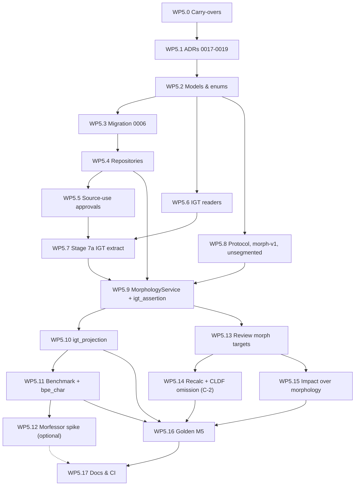

# M5 IGT and Morphology Graph Implementation Plan

> **Policy reconciliation (ADR-0025 & ADR-0018).** ADR-0025 authorizes processing
> and training of sources present under `var/external/`; licence, ownership, and
> register metadata do not create gates. Explicit `exclude`, operation-specific
> operator restrictions, revocation, third-party egress, and redistribution rules
> retain their stated effects. ADR-0022–0024 are superseded **as authorization gates**.
> The synthetic `04-igt` fixture exists at `tests/golden/fixture/sources/04-igt/manifest.yaml`,
> outside `var/external/`, and explicitly uses `review_required`. Preserve the ADR-0018
> overlay as its declared mechanism: grants lift applicable `review` baselines only,
> explicit denials remain effective, and withdrawal tightens computed eligibility. The
> ADR-0018 M5 list excluding approval of training and synthetic-support operations does
> **not** reinstate a training gate for ADR-0025-covered sources.

> For agentic workers: juniors implement, seniors review batch packages, orchestrator
> verifies diffs and CI. Cards return as `review` on `tsk`; the owner alone closes them.
> Preserve ★ second-family review gates. No implementation is authorized by this document alone.

**Status:** Approved for execution — Chief Architect (Opus 5.5) under delegated authority, 2026-10-16. Senior execution refresh approved — Codex GPT-6.1-Terra, 2026-10-27. Owner ratification pending (DELEGATED-DECISIONS §2; carry-over C-5).
**Date:** 2026-10-16 (refreshed 2026-10-27)
**Goal:** Import interlinear glossed text (Toolbox and Xigt XML) as immutable observations, persist an auditable morphology graph (`Morpheme`, `Allomorph`, `Feature`, `MorphAnalysis`, `MorphSegment`, segment–feature assignments), preserve competing and unknown analyses, deliver a versioned `morph-v1` scoring policy, a morphology benchmark harness with baselines, the first morphology adapter (IGT-constrained affix projection), review over morphology targets, and golden coverage of phenomena 5, 6, 7, 10 and 11.
**Architecture:** IGT import is split into an observation step (Stage 7a: `IGTObservation` + text-tier `Segment`, reusing the M2 normalize/tokenize stages unchanged) and an assertion step (Stage 7b: IGT-asserted morphology hypotheses on `TokenOccurrence`s). Stage 8 adapters are pure, registry-resolved and produce candidates only. The occurrence (`TokenOccurrence`) is the only analysis target. Review stays the sole writer of `validated`. A source-use approval overlay (ADR-0018) lets an authorized governance steward turn a `review_required` operation into `allow` for a source with a `review` baseline (such as the golden `04-igt` test fixture), preserving ADR-0025's presence-based authorization for all repository-present external sources.
**Tech stack:** Python 3.12+, uv, Pydantic v2, SQLAlchemy 2, Alembic, PostgreSQL 16+, Typer, stdlib `xml.etree` (hardened), pytest/Hypothesis, Ruff/mypy. Optional extra only: `morfessor` (WP5.12 spike; never in base CI).

---

## 1. Baseline and scope

WP5.0–WP5.4 have landed in repository history:
- `3e471dd` WP5.0: M4 carry-overs (Gate 29 approved)
- `af3eb72` WP5.1: ADR-0017 / ADR-0018 / ADR-0019 (Gate 30 approved)
- `526987a` WP5.2: Domain models, enums, spans, MorphologyProfile (Gate 31 approved)
- `c1381d1` WP5.3: Migration 0006 + table mappings (Gate 32 approved)
- `8e55ef5` WP5.4: Repository layer: protocol, memory, PostgreSQL (Gate 33 approved)

Migration head: `0006_m5_igt_and_morphology`.
CI baseline at refresh: `2689 passed, 0 skipped, 41 deselected` in full PostgreSQL gate.

M5 is defined by `docs/DEVELOPMENT.md` §M5:
> Deliver Xigt-compatible IGT import, Morpheme/Allomorph/MorphAnalysis/MorphSegment/Feature models, competing analyses, morphology benchmark harness and first morphology adapter. Only after M5 should synthetic generation be designed in code.

### Scope fences

- **No synthetic generation, no model training, no generator code** (DEVELOPMENT.md; DELEGATED-DECISIONS §2). `direct_training` and `synthetic_generation_support` cannot be approved in M5 (ADR-0018 §3).
- **No IGT or morphology export.** ADR-0016 defers IGT/example sentences in exports to their own ADR; M5 does not write one. No Xigt export command, no CLDF morphology tables. The Xigt *writer* exists only as a test helper for round-trip proofs.
- **No `Paradigm` / `ParadigmSlot` in M5.** DEVELOPMENT.md §M5 does not list them, the fixture contains no paradigm evidence and MORPHOLOGY.md calls paradigms sparse. Deferred, recorded in ADR-0017 §9.
- **No Form-level materialized analyses** (OPEN-MORPH-003 resolved for M5: occurrence-level only; Form views are queries). Reversible by an additive column + migration.
- **No IGT input to lexical induction (Stage 6).** M4 drift item 4 deferred IGT "to M5"; M5 deliberately does not widen Stage 6. Root morphemes carry contact-language glosses; linking `Morpheme(role=root)` to `Lexeme` is deferred (ADR-0017 §9).
- **No automatic morpheme merging across strings or across runs.** "Do not create separate morphemes solely because strings differ. Do not merge strings solely because functions seem similar" (MORPHOLOGY.md §Allomorphy). Allomorph grouping of distinct strings is a human `modify` decision only.
- **No authoritative-import validation path.** `ValidationBasisKind.AUTHORITATIVE_IMPORT` exists, but in M5 nothing an importer does produces `validated`; the review service remains the only writer (ADR-0017 §7).
- **No feature mapping to external namespaces** (`unimorph:`/`ud:`). Imported gloss labels become `local:<lang>:<LABEL>` features verbatim. Mapping attempts are deferred (Stage 7 invariant: "do not silently normalize source analysis into a universal scheme").
- **Language-specific behavior only in profiles.** Boundary marks, unknown-gloss markers, Toolbox marker aliases and stem-length limits live on `MorphologyProfile` (WP5.2); generic code contains no Marúbo rule.

---

## 2. Conflicts and gaps (G1–G16)

| ID | Evidence / gap | Resolution / owner |
|---|---|---|
| G1 | `04-igt` is `review_required` (`manifest.yaml:10`); `read_raw`/`extract`/`normalize`/`distill_morphology`/`evaluation` all resolve `review_required` → blocked (ADR-0007 §3). ADR-0007 Consequences: "Review workflows … will need a way to record approvals … That mechanism is deliberately not designed here." | Source-use approval overlay: append-only `source_use_approval` rows; `effective_policy(repo, source)` adds approved operations to `allow` only where the mode's baseline is `review` (ADR-0018, WP5.5). The golden manifest is **not** edited (DELEGATED-DECISIONS §4 precedent: editing a manifest changes a governance fact and churns M1 snapshots). Sources present in `var/external/` remain authorized under ADR-0025. |
| G2 | The `source` row trigger (`langpipe_source_guard`, 0001) forbids changing anything but `status`, so "amend the policy pointer" is unavailable without weakening an M1 invariant. | Overlay, not amendment: no `source`/`source_policy` row changes. Rejected alternative recorded in ADR-0018. |
| G3 | 25 `resolve`/`resolve_many`/`effective_decision` call sites and 18 `get_policy` call sites across 17 modules. An overlay applied at only some sites would make decisions inconsistent. | All decision paths go through `governance.approvals.effective_policy`; a guard test fails if a module outside `governance/` and `storage/` calls `get_policy(` (WP5.5). |
| G4 | `DOMAIN-MODEL.md` names `IGTObservation` but no model or table exists; M2 extraction skips IGT objects (`extraction/service.py:216`, reason `igt_not_in_m2`). | `IGTObservation` model + `igt_observation` table (WP5.2/5.3); dedicated `langpipe igt extract` (WP5.7). `langpipe text extract` keeps skipping IGT with the unchanged reason string (M2 snapshot stability; documented). |
| G5 | Normalization requires an `EXTRACTION`-stage input run (`normalization/service.py:147`); tokenization requires `NORMALIZATION`. | Stage 7a runs as `RunStage.EXTRACTION`, tool `langpipe.igt-extract` (wordlist precedent, `lexicon/service.py:178`), so M2 normalize/tokenize consume IGT text-tier segments unchanged. Stage 7b (assertion) runs as `RunStage.IGT_IMPORT`. |
| G6 | "Stages must not write through multiple semantic layers at once" (AGENTS.md). | 7a writes observations only (`IGTObservation`, `Segment`); 7b writes inference only (morphology hypotheses + evidence). Separate runs, separate transactions. |
| G7 | Analysis target: MORPHOLOGY.md prefers `TokenOccurrence`; IGT words are not tokens. | IGT text tier becomes a `Segment`; 7b maps IGT words to that segment's tokens by sequential exact match (normalized under the tokenization run's pinned profile). Unmapped words are counted, never forced (WP5.9). |
| G8 | Phenomenon 7 (unknown morpheme): `PHENOMENA.md:16` says the fixed corpus has no unglossed component; `wesa-ra` is not observed missing-gloss evidence. | New synthetic fixture outside `fixture/sources/`: `tests/golden/fixture/morphology/unknown-gloss.{txt,manifest.yaml}` (`direct`, public), one record glossed with the Toolbox unknown marker `***` (M3 `alignment/` and M4 `lexicon/` precedent; M1/M2 untouched). |
| G9 | Phenomena 10/11 need IGT/morpheme review targets; M4 review rejects non-lexical task types (`review/base.py` `M4_TASK_TYPES`). | Widen to `morphology_segmentation` (target `morph_analysis`) and `morpheme_function` (target `morpheme`) via a per-entity target-handler table; lexical behavior unchanged and regression-tested (WP5.13). |
| G10 | `lifecycle.check_transition` forbids `candidate → validated`, but M4 review `accept` validates `candidate` directly (`review/service.py` `_LIFECYCLE_WRITES`). | M5 follows the landed review semantics (code is the contract); ADR-0017 §7 records the discrepancy as known; not changed in M5 (changing it alters M4 golden behavior). |
| G11 | Fusion (OPEN-MORPH-001): `wesa` glossed `ir.PST` (IGT-1) — one morph, lexical meaning + grammatical label. | M5: one segment links at most one Morpheme and may realize several Features. `ir.PST` → Morpheme(`wesa`, gloss `por:ir`) + segment feature `local:qaa:PST`. One-segment-many-morphemes stays OPEN (ADR-0017 §4). |
| G12 | Affix vs clitic and inflection vs derivation are uncertain (MORPHOLOGY.md). | Importer assigns roles only from explicit source markers: `-x` → `unknown_bound`, `=x` → `clitic`, morph with a lexical gloss → `root`, unknown gloss → `unknown`. Competing role hypotheses stay OPEN-MORPH-004; revisable by review `modify`. |
| G13 | `\m` tier may give underlying forms that differ from the surface (common in real IGT). | If concatenated morphs ≠ the token surface modulo profile boundary marks, the word gets no `MorphAnalysis`; morphemes/allomorphs are still recorded with `form_basis=underlying`; counted as `words_unmapped_underlying`. OPEN-MORPH-005. |
| G14 | Stage 8 quality gate: "Benchmark … before method promotion". | ADR-0019: a method's analyses are policy-promotable only if the method is listed in `morph-v1`'s promotion allowlist with a pinned benchmark report. M5 ships an **empty** allowlist for induction methods; only IGT-asserted hypotheses can reach `supported`. |
| G15 | Benchmark leakage: the projection adapter learns its inventory from IGT, and the gold set is IGT. | Benchmark refuses (`BenchmarkLeakage`) when any `IGTObservation` named by the gold set is a lineage ancestor of the evaluated run's inventory (WP5.11). |
| G16 | C-2: the CLDF exporter counts `stale_dependent` under `omitted` while still exporting the row (`cldf/exporter.py:580-583`), so the key name is false. | Bounded recalculation of direct dependents + `recalculated` lineage kind; the exporter then truly omits rows with an unresolved stale flag; `cldf-export-report` → schema_version 2 (WP5.14). |

---

## 3. Global constraints and execution gates

1. **Raw sources, segments, tokens, IGT observations and morph segments are immutable.** Changing a `MorphAnalysis` never modifies a `TokenOccurrence` (GOLDEN-FIXTURE.md:47).
2. **Observation ≠ inference.** `IGTObservation` preserves source tiers verbatim; morphemes, allomorphs and analyses are hypotheses with their own lifecycle.
3. **Machine output never yields `validated`.** Only an authorized `ReviewDecision` does; a test asserts no morphology/IGT module path writes `validated` (pattern of WP4.4).
4. **Ambiguity is preserved.** Competing analyses are distinct rows; accepting one never rejects, deprecates or demotes another; an unsegmented analysis is always representable.
5. **Lineage everywhere.** Every morpheme, allomorph, analysis and evidence item has `derived_from` edges to its producing run and inputs (IGT observations, tokens, inventory morphemes).
6. **Governance through one door.** Every operation decision goes through `effective_policy`; approvals only lift `review` baselines; `deny`, `default_deny` and `hard_deny` are never lifted.
7. **No restricted text on stdout, in logs or in reports.** CLI and reports carry IDs, enums, counts and digests only; IGT tiers and glosses never appear (SCHEMAS.md report rule).
8. **No third-party API, no network** in any M5 path.
9. **Compiler-free CI stays green with zero skips** (`scripts/ci.sh`, `LANGPIPE_REQUIRE_POSTGRES=1`). Optional extras are behind deselected markers.
10. **Every persisted format change** ships migration + tests + docs (Invariant 11).
11. **Sequential PostgreSQL testing.**
12. **Two-family review gate** (§8): every WP gets the senior reviewer; WPs marked ★ additionally get a second reviewer family, looped until both are clean. BUG/RISK findings are fixed immediately; every NIT is verified against the code before acting.

---

## 4. Target architecture and data flow

```text
Registered IGT source (toolbox .txt | Xigt .xml)          [ADR-0018 approvals if review_required]
  -> Stage 7a  langpipe igt extract     RunStage.EXTRACTION, tool langpipe.igt-extract
       reader: toolbox_igt@0.1.0 | xigt_xml@0.1.0 (pure, registry-resolved)
       -> IGTObservation (verbatim tiers, parsed words/morphs/glosses, parse_status, locator)
       -> Segment (text tier, target language)                     [observation layer only]
       -> igt-extraction-report v1
  -> M2 normalize -> M2 tokenize (unchanged)                      -> TokenOccurrences
  -> Stage 7b  langpipe igt assert      RunStage.IGT_IMPORT, method igt_assertion@0.1.0
       word->token mapping (exact, normalized; unmapped counted)
       -> Morpheme / Allomorph candidates (per-run identity key; no cross-run merge)
       -> Feature vocabulary (local:<lang>:<LABEL>) + morph_segment_feature (basis=igt_gloss)
       -> MorphAnalysis (segmented) + MorphSegments on IGT tokens
       -> EvidenceItem(kind=igt_assertion) ; morph-v1 score ; lineage
       -> morphology-induction-report v1
  -> Stage 8   langpipe morph induce    RunStage.MORPHOLOGY_INDUCTION
       methods: unsegmented@0.1.0 | igt_projection@0.1.0 | bpe_char@0.1.0 | [morfessor_baseline@0.1.0 optional]
       inputs: one tokenization run (+ pinned inventory run for igt_projection)
       -> MorphAnalysis candidates (competing; unsegmented abstentions) + evidence + lineage
  -> Benchmark langpipe morph benchmark RunStage.EVALUATION
       frozen MorphGold v1 (or derived from held-out IGT records) ; leakage guard
       -> morphology-benchmark-report v1 (BENCHMARK_REPORT)
  -> Stage 10  langpipe review          task types morphology_segmentation | morpheme_function
       accept -> validated | reject -> rejected | modify -> successor | uncertain/defer -> unchanged
       stale_dependent flags (morpheme -> analyses linking it) -> langpipe review recalc (C-2)
  -> Lineage   revocation / approval-withdrawal impact over IGT + morphology (computed, ADR-0015)
```

---

## 5. Work package overview and dependency order

| WP | Title | Depends | Status | Gate | ★ |
|---|---|---|---|---|---|
| WP5.0 | M4 carry-overs (C-1, C-3, C-4, C-5) | — | Landed (`3e471dd`) | 29 | |
| WP5.1 | ADR-0017 / ADR-0018 / ADR-0019 | WP5.0 | Landed (`af3eb72`) | 30 | ★ |
| WP5.2 | Domain models, enums, spans, MorphologyProfile | WP5.1 | Landed (`526987a`) | 31 | |
| WP5.3 | Migration 0006 + table mappings | WP5.2 | Landed (`c1381d1`) | 32 | ★ |
| WP5.4 | Repository layer (protocol, memory, PostgreSQL) | WP5.3 | Landed (`8e55ef5`) | 33 | |
| WP5.5 | Source-use approvals (governance overlay, CLI) | WP5.4 | In progress (#210) | 34 | ★ |
| WP5.6 | IGT readers: Toolbox + Xigt XML (pure) | WP5.2 | Open (#211) | 35 | |
| WP5.7 | Stage 7a IGT extract service + CLI | WP5.5, WP5.6 | Open (#212) | 36 | |
| WP5.8 | Morphology protocol, `morph-v1` scoring, registry, `unsegmented` | WP5.2 | Open (#213) | 37 | |
| WP5.9 | Stage 7b/8 MorphologyService, `igt_assertion`, CLI | WP5.4, WP5.7, WP5.8 | Open (#214) | 38 | ★ |
| WP5.10 | First morphology adapter: `igt_projection@0.1.0` | WP5.9 | Open (#215) | 39 | |
| WP5.11 | Benchmark harness, `MorphGold`, `bpe_char` baseline, CLI | WP5.10 | Open (#216) | 40 | |
| WP5.12 | Morfessor baseline spike (optional extra; non-blocking) | WP5.11 | Open (#217) | 41 | |
| WP5.13 | Review over morphology targets | WP5.9 | Open (#218) | 42 | ★ |
| WP5.14 | Stale-dependent recalculation + truthful CLDF omission (C-2) | WP5.13 | Open (#219) | 43 | |
| WP5.15 | Revocation / approval-withdrawal impact over IGT + morphology | WP5.13 | Open (#220) | 44 | |
| WP5.16 | Golden fixture M5 | WP5.10, WP5.11, WP5.14, WP5.15 | Open (#221) | 45 | ★ |
| WP5.17 | Contract documentation & CI accounting | WP5.16 (and WP5.12 outcome) | Open (#222) | 46 | |



WP5.6 and WP5.8 are pure and MAY run in parallel with WP5.3–WP5.5 (no shared files). Database WPs stay sequential.

---

## 6. Detailed work packages

> Paths below are the real module layout (M4 drift lesson: M4-PLAN cited `storage/repositories/sql.py`, which never existed). Repository protocol: `src/langpipe/storage/repository.py`; in-memory: `src/langpipe/storage/memory.py`; PostgreSQL: `src/langpipe/storage/db/repository.py` + `src/langpipe/storage/db/tables.py`. Writers are named `add_*` (M4 convention).

### WP5.0 — M4 carry-overs

**Depends:** none. **Size:** 1 session. **Gate 29.**
**Own:** `src/langpipe/schemas/registry.py`, `schemas/*.v1.schema.json` (generated), `src/langpipe/domain/models/base.py`, `docs/SCHEMAS.md` (status note), `docs/GOVERNANCE.md` (backlog), `docs/implementation/DELEGATED-DECISIONS.md`, `tests/unit/test_schema_registry.py` (or existing schema test), `tests/unit/test_domain_models_warnings.py`.
**Produces:** generated JSON Schemas for M4 models; warning-free model import; recorded governance backlog and M5 delegated decisions.

- [ ] **C-1:** add `Concept`, `Lexeme`, `FormLexemeLink`, `Sense`, `ReviewTask`, `ReviewDecision` to `SCHEMA_MODELS`; run `uv run python -m langpipe.schemas generate`; commit the six `schemas/*.v1.schema.json`; `schemas check` then guards them. (`form-lexeme-link` is added too: it has a `SCHEMA_NAME` and is persisted; C-1 listed five by oversight.)
- [ ] **C-3:** the warning is pydantic reporting that field `register` shadows `ABCMeta.register` (pydantic's metaclass derives from `ABCMeta`). The field name is a persisted contract (DB column, JSON key, golden snapshots) and stays. Add one narrowly matched `warnings.filterwarnings("ignore", message=r'Field name "register" in "(Lexeme|Sense|EvidenceItem)" shadows', category=UserWarning)` in `domain/models/base.py` with a comment naming the cause. Test: importing `langpipe.domain.models` under `warnings.simplefilter("error")` raises nothing; a deliberately shadowing test model with a different field name still warns (proves the filter is narrow). No serialized shape changes; golden snapshots byte-identical.
- [ ] **C-4:** `GOVERNANCE.md` new `## Backlog` entry: reviewer and approver identity is an asserted string checked against process-local configuration; no authentication; acceptable for single-operator synthetic work; MUST be addressed before multi-reviewer community use or any real-data approval (applies to ADR-0018 approvers too).
- [ ] **C-5:** `DELEGATED-DECISIONS.md` entry §5 "M5 plan": the decisions in §2 (G1, G8, G14, G16) and the fences in §1, with reversal instructions; reaffirm that no real Marúbo data receives `validated` and no real source receives a source-use approval without the owner.
- [ ] Acceptance: `uv run python -m langpipe.schemas check`; `uv run pytest tests/unit -q -W error::UserWarning -k "schema or warning"`; `scripts/ci.sh` shows 0 warnings of the `register` kind.

### WP5.1 — ADR-0017, ADR-0018, ADR-0019 ★

**Depends:** WP5.0. **Size:** 1 session. **Gate 30.**
**Own:** `docs/adr/0017-igt-observation-and-morphology-graph.md`, `docs/adr/0018-source-use-approvals.md`, `docs/adr/0019-morphology-benchmark-and-method-promotion.md`, `docs/adr/README.md`, `docs/MORPHOLOGY.md` (OPEN annotations only).
**Produces:** three ADRs, status `Accepted (delegated; owner ratification pending)`; MORPHOLOGY.md OPEN items annotated with their M5 disposition. Content is specified in §7 of this plan; the ADRs restate it as decisions with context, consequences and rejected alternatives. No code.

- [ ] Acceptance: senior + second-family review agree the ADRs contain every decision that WP5.2–WP5.16 rely on (checklist: §7.1–§7.3 items each map to an ADR clause).

### WP5.2 — Domain models, enums, spans, MorphologyProfile

**Depends:** WP5.1. **Size:** 1 session. **Gate 31.**
**Own:** `src/langpipe/domain/models/igt.py`, `src/langpipe/domain/models/morphology.py`, `src/langpipe/domain/models/approval.py`, `src/langpipe/morphology/spans.py`, modify `src/langpipe/domain/enums.py`, `src/langpipe/domain/ids.py`, `src/langpipe/domain/models/__init__.py`, `src/langpipe/languages/base.py`, `src/langpipe/languages/mzr/profile.py`, `src/langpipe/schemas/registry.py`; tests `tests/unit/test_igt_models.py`, `tests/unit/test_morphology_models.py`, `tests/unit/test_morph_spans.py`, `tests/unit/test_approval_model.py`.
**Produces:** pure frozen Pydantic models (§7.4), enums, the canonical segmentation signature, and the profile hook.

- [ ] `IdPrefix`: reuse `MORPH_ANALYSIS="ma"`, `MORPHEME="morph"`; add `MORPH_SEGMENT="mseg"`, `ALLOMORPH="allo"`, `FEATURE="feat"`, `IGT_OBSERVATION="igt"`, `SOURCE_USE_APPROVAL="sua"`.
- [ ] `EntityType`: add `igt_observation`, `feature`, `morpheme`, `allomorph`, `morph_analysis`, `morph_segment`, `source_use_approval`.
- [ ] New enums: `MorphRole` (`root`, `lexical_stem`, `derivational_affix`, `inflectional_affix`, `clitic`, `reduplicant`, `bound_lexical`, `unknown_bound`, `unknown`); `AnalysisKind` (`segmented`, `unsegmented`); `AllomorphConditioning` (`phonological`, `morphosyntactic`, `lexical`, `unknown`); `FormBasis` (`surface`, `underlying`); `Abstention` (`insufficient_evidence`, `conflicting_evidence`, `unsupported_language_or_domain`, `human_review` — EVIDENCE-AND-CONFIDENCE.md §Abstention); `IgtFormat` (`toolbox`, `xigt`); `IgtParseStatus` (`ok`, `tier_mismatch`, `missing_tier`, `unparsed`); `FeatureAssignmentBasis` (`igt_gloss`, `adapter`); `ApprovalAction` (`grant`, `withdraw`); `LineageKind.RECALCULATED = "recalculated"` (WP5.14 writer); `AuditEventType.SOURCE_USE_APPROVED`, `SOURCE_USE_WITHDRAWN`.
- [ ] `morphology/spans.py`: `segmentation_signature(analysis_kind, segments)` = sha256 of canonical JSON of `[(start, end, is_zero, morpheme_id|null)]`; `check_segments(surface, segments, boundary_marks)` — ordinals contiguous from 0; spans ascending, non-overlapping, within `len(surface)`; `surface == slice` for every segment; zero-width only with `is_zero=True`; every uncovered code point is a profile boundary mark; at least one segment. Hypothesis property tests: signature is order-insensitive to construction but sensitive to any span/morpheme change; random valid segmentations always pass, random corruptions always fail.
- [ ] `MorphologyProfile` (frozen dataclass on `LanguageProfile.morphology`, default generic): `boundary_marks=("-", "=")`, `clitic_marks=("=",)`, `unknown_gloss_markers=("***", "?", "??")`, `toolbox_markers={"text": ("\\t", "\\tx"), "morphs": ("\\m", "\\mb"), "glosses": ("\\g", "\\ge"), "translation": ("\\f", "\\ft")}`, `min_stem_length=2`, `grammatical_label_pattern=r"^[A-Z0-9]+$"`. The mzr profile copies the generic values and marks them "working assumption" in a comment pointing at `docs/languages/mzr.md` §Open items.
- [ ] Register the new models in `SCHEMA_MODELS` (`igt-observation`, `feature`, `morpheme`, `allomorph`, `morph-analysis`, `morph-segment`, `morph-segment-feature`, `source-use-approval`, `morph-gold`) and regenerate.
- [ ] Acceptance: `uv run pytest tests/unit/test_igt_models.py tests/unit/test_morphology_models.py tests/unit/test_morph_spans.py tests/unit/test_approval_model.py -q`; `schemas check`.

### WP5.3 — Migration 0006 + table mappings ★

**Depends:** WP5.2. **Size:** 1 session. **Gate 32.**
**Own:** `migrations/versions/0006_m5_igt_and_morphology.py`, modify `src/langpipe/storage/db/tables.py`, `tests/integration/test_migrations.py`.
**Produces:** revision `0006_m5_igt_and_morphology`, `down_revision = "0005_review_stale_dependent"`, exactly as §7.5.

- [ ] Enum tuples are literal copies (the migration never imports application code; 0004 pattern). Entity-type, lineage-kind and audit-event CHECKs are replaced with the extended lists.
- [ ] Append-only triggers (`langpipe_forbid_mutation`) on `igt_observation`, `feature`, `morph_segment`, `morph_segment_feature`, `source_use_approval`.
- [ ] New guard function `langpipe_hypothesis_guard()` on `morpheme`, `allomorph`, `morph_analysis`: DELETE refused; UPDATE may change only `status` and `score_breakdown` (same `to_jsonb(NEW) - … IS DISTINCT FROM` pattern as `langpipe_source_guard`).
- [ ] Downgrade refuses (before any DDL) while any M5 row, any `object_registry` entry of an M5 entity type, any `recalculated` lineage edge or any M5 audit event exists.
- [ ] Tests: upgrade 0005→0006→downgrade→upgrade on PostgreSQL; every CHECK rejects an off-enum value; every trigger rejects the forbidden write; the hypothesis guard allows a status+score update and rejects a `method` or `target_token_id` change; downgrade refusal is transactional (schema intact afterwards).
- [ ] Acceptance: `LANGPIPE_REQUIRE_POSTGRES=1 uv run pytest tests/integration/test_migrations.py -q`.

### WP5.4 — Repository layer

**Depends:** WP5.3. **Size:** 1 session. **Gate 33.**
**Own:** modify `src/langpipe/storage/repository.py`, `src/langpipe/storage/memory.py`, `src/langpipe/storage/db/repository.py`; `tests/storage/test_morphology_repository.py`, `tests/storage/test_approval_repository.py`.
**Produces:** shared persistence API with contract tests running against memory and PostgreSQL.

- [ ] `add_igt_observation`, `get_igt_observation`, `list_igt_observations_for_run`, `list_igt_observations_for_object`.
- [ ] `add_feature` (idempotent on `(namespace, label)`: returns the existing row), `get_feature`, `get_feature_by_label`, `list_features`.
- [ ] `add_morpheme`, `get_morpheme`, `get_morpheme_for_update`, `list_morphemes_for_run`, `set_morpheme_status(id, status, breakdown)`.
- [ ] `add_allomorph`, `list_allomorphs_for_morpheme`, `set_allomorph_status`.
- [ ] `add_morph_analysis` (with its segments and segment-feature rows atomically; validates via `check_segments` against the token surface before insert), `get_morph_analysis`, `get_morph_analysis_for_update`, `list_morph_analyses_for_token`, `list_morph_analyses_for_run`, `list_analyses_linking_morpheme`, `list_morph_segments(analysis_id)`, `list_segment_features(segment_id)`, `set_morph_analysis_status`.
- [ ] `add_source_use_approval`, `list_source_use_approvals(source_id)`.
- [ ] Row locks (`with_for_update`) on the `*_for_update` readers; lock order documented (task → target → dependents), matching WP4.3.
- [ ] Acceptance: `LANGPIPE_REQUIRE_POSTGRES=1 uv run pytest tests/storage/test_morphology_repository.py tests/storage/test_approval_repository.py -q`.

### WP5.5 — Source-use approvals ★

**Depends:** WP5.4. **Size:** 2 sessions. **Gate 34.**
**Own:** `src/langpipe/governance/approvals.py`, modify every module listed by `grep -rln "get_policy(\|resolve(\|resolve_many(\|effective_decision(" src/langpipe` (17 at plan time), modify `src/langpipe/cli/source.py`, `src/langpipe/review/authority.py` (role constant only); tests `tests/unit/test_effective_policy.py` (Hypothesis), `tests/service/test_source_use_approval.py`, `tests/unit/test_cli_source_approve.py`, `tests/unit/test_governance_single_door.py`.
**Produces:** the ADR-0018 overlay, its CLI and the single-door guard.

- [ ] `APPROVABLE_OPERATIONS` (M5): `read_raw`, `extract`, `normalize`, `align`, `distill_lexicon`, `distill_morphology`, `distill_grammar`, `evaluation`. Never: `direct_training`, `synthetic_generation_support`, `human_review`, any outward operation.
- [ ] `effective_policy(repo, source) -> EffectivePolicy` (`PolicyLike`): `mode`, `deny` unchanged; `allow = policy.allow ∪ {op | latest approval action for (source, op) is grant ∧ baseline(mode, op) is REVIEW}`. Revoked sources are unaffected (revocation already denies everything, ADR-0015).
- [ ] `record_approval(source_id, operation, action, approver_id, approver_role, basis)`: approver must hold `governance_steward` in the `ReviewAuthorityRegistry` for one of the source's languages; operation must be approvable *and* have a `review` baseline under the source's mode (else `PolicyConflict`); `basis` nonempty; writes the approval row, an audit event, and a minimal succeeded `HUMAN_REVIEW` creator run (review-service precedent) in one transaction.
- [ ] Rewire every policy-decision call site to `effective_policy`; `effective_decision`/`lineage_eligibility` use it internally.
- [ ] `test_governance_single_door.py`: AST scan fails if any module outside `governance/` and `storage/` calls `get_policy`.
- [ ] Properties (Hypothesis over modes × operations × approval sequences): approvals never turn `deny` into anything else; never lift `default_deny`/`hard_deny`; withdrawing only tightens; with no approvals, every decision equals the pre-M5 `resolve`.
- [ ] Regression: all M1–M4 golden tests unchanged (no approvals exist there).
- [ ] CLI: `langpipe source approve --source REF --operation OP --approver ID --role governance_steward --basis TEXT` and `langpipe source withdraw-approval …`; stdout `approval_id=… source_id=… operation=… action=…` only; `source show` lists effective approved operations.
- [ ] Acceptance: `LANGPIPE_REQUIRE_POSTGRES=1 uv run pytest tests/unit/test_effective_policy.py tests/unit/test_governance_single_door.py tests/service/test_source_use_approval.py tests/unit/test_cli_source_approve.py tests/golden -q`.

### WP5.6 — IGT readers (pure)

**Depends:** WP5.2. **Size:** 1 session. **Gate 35.**
**Own:** `src/langpipe/igt/__init__.py`, `src/langpipe/igt/base.py`, `src/langpipe/igt/toolbox.py`, `src/langpipe/igt/xigt.py`, `src/langpipe/igt/gloss.py`, `src/langpipe/igt/registry.py`; `tests/unit/test_igt_toolbox.py`, `tests/unit/test_igt_xigt.py`, `tests/unit/test_igt_gloss.py`; fixtures `tests/fixtures/igt/*.txt`, `tests/fixtures/igt/*.xml`.
**Produces:** `IgtReader` protocol (`read(data, ctx, profile) -> IgtDocument`), two registered readers, the Leipzig gloss splitter, a test-only Xigt writer for round-trip proofs. Specified in §7.6.

- [ ] Strict UTF-8 via `extraction.base.decode_utf8`; byte-level failure → `ExtractionFailed("decode_error")`; per-record problems never fail the document.
- [ ] Xigt: stdlib `xml.etree.ElementTree` with a pre-parse refusal of any `<!DOCTYPE`/`<!ENTITY` (no network, no entity expansion), a byte-size cap, and refusal of unknown tier references (`unparsed`, not crash).
- [ ] Round-trip: `toolbox → IgtDocument → xigt writer (test helper) → xigt reader → IgtDocument` is equal for the parsed layer; verbatim tiers are preserved byte-for-byte for Toolbox.
- [ ] Hypothesis: arbitrary marker/line soup never raises except the typed decode error; every input line is accounted for in exactly one record's verbatim tiers or the header.
- [ ] No reader logs or raises with content; error messages carry record ordinals and fixed codes only.
- [ ] Acceptance: `uv run pytest tests/unit/test_igt_toolbox.py tests/unit/test_igt_xigt.py tests/unit/test_igt_gloss.py -q`.

> **Landed scope widening** (WP5.6, Gate 35): beyond the "Own" list above, WP5.6 also added
> three extraction failure codes to `domain/errors.py` (`EXTRACTION_FAILURE_CODES`:
> `xml_too_large`, `xml_malformed`, `xml_entity_expansion_refused`) — the whole-document
> refusals of the Xigt reader must be typed, and `ExtractionFailed` validates codes against
> that set. Two recorded decisions inside WP5.6's own scope: (1) stdlib ElementTree exposes
> no source line numbers, so synthesized Xigt tier lines carry the item's 1-based position
> within its tier as `line_number`; (2) a translation line without an explicit language
> prefix is keyed `und` in `IgtRecord.translations`.

### WP5.7 — Stage 7a IGT extract service + CLI

**Depends:** WP5.5, WP5.6. **Size:** 1 session. **Gate 36.**
**Own:** `src/langpipe/igt/service.py`, `src/langpipe/cli/igt.py`, modify `src/langpipe/cli/app.py`; possibly `src/langpipe/normalization/service.py` (only if the WP finds a tool-name restriction — none is visible at `:140-160`); `tests/service/test_igt_extract_service.py`, `tests/unit/test_cli_igt.py`.
**Produces:** `IgtExtractService.extract(source_ref, reader=None, language=None, contact_language=None)`.

- [x] Governance: `READ_RAW` and `EXTRACT` via `effective_policy` under sorted source row locks (`ingest/governed.py` helpers); denial records `POLICY_DENIED`, no run.
- [x] Reads verified raw bytes; resolves reader by media type (`text/plain` → `toolbox_igt@0.1.0`, `application/xml`/`text/xml` → `xigt_xml@0.1.0`) or explicit `--reader`.
- [x] Persists per record: one `IGTObservation` and, when a text tier exists, one `Segment` (`language` = target, `locator={"igt_ref": …, "record_ordinal": n, "line_start": a, "line_end": b}`, `raw_text` = the text-tier line(s) joined by one space); the observation references the segment. Lineage: segment and observation `extracted_from` the source object.
- [x] Run: `RunStage.EXTRACTION`, tool `langpipe.igt-extract`, config pins reader + profile + languages; idempotent reuse by config/input hash; whole-run rollback on failure.
- [x] Report `igt-extraction-report` v1 (`EXTRACTION_REPORT`): `schema`, `schema_version`, `run_id`, `reader`, `source_object_ids`, `records`, `parse_status_counts`, `segments`, `words`, `morphs`, `unknown_marker_counts`. IDs/counts only.
- [x] Prove the chain: M2 `normalize` + `tokenize` accept the run and produce tokens for IGT segments (service test).
- [x] CLI `langpipe igt extract SOURCE_REF [--reader R] [--language L] [--contact-language L]`; stdout key=value IDs/counts.
- [x] Acceptance: `LANGPIPE_REQUIRE_POSTGRES=1 uv run pytest tests/service/test_igt_extract_service.py tests/unit/test_cli_igt.py -q`.

### WP5.8 — Morphology protocol, `morph-v1` scoring, registry, `unsegmented`

**Depends:** WP5.2. **Size:** 1 session. **Gate 37.**
**Own:** `src/langpipe/morphology/__init__.py`, `src/langpipe/morphology/base.py`, `src/langpipe/morphology/scoring.py`, `src/langpipe/morphology/registry.py`, `src/langpipe/morphology/adapters/__init__.py`, `src/langpipe/morphology/adapters/unsegmented.py`; `tests/unit/test_morph_scoring.py`, `tests/unit/test_morph_registry.py`, `tests/unit/test_morph_unsegmented.py`, `tests/unit/test_morph_never_validates.py`.
**Produces:** `MorphologyInducer` protocol + DTOs, `morph-v1` policy (§7.8), versioned registry (lexicon-registry pattern, `UnsupportedMethod`), null baseline.

- [ ] `MorphologyInductionInput`: `run_id`, `language`, `tokens` (pinned, with `normalized_surface`), `profile`, optional `inventory` (morphemes + allomorphs + their evidence, pinned by run id), optional `training_tokens` (for unsupervised baselines), `policy`.
- [ ] `MorphologyInductionOutput`: `analyses` (each with segments + feature assignments), `morphemes`, `allomorphs`, `features`, `evidence_items`, `lineage_edges`, `abstentions` (token id → reason).
- [ ] `unsegmented@0.1.0`: one whole-surface segment, `morpheme_id=None`, `role=None`, `analysis_kind=unsegmented`, `abstention=insufficient_evidence`.
- [ ] `test_morph_never_validates.py`: AST scan of `morphology/` and `igt/` — no expression constructs `LifecycleStatus.VALIDATED`; plus a property test that `morph-v1` never returns `validated`.
- [ ] Acceptance: `uv run pytest tests/unit/test_morph_scoring.py tests/unit/test_morph_registry.py tests/unit/test_morph_unsegmented.py tests/unit/test_morph_never_validates.py -q`.

### WP5.9 — Stage 7b/8 MorphologyService, `igt_assertion`, CLI ★

**Depends:** WP5.4, WP5.7, WP5.8. **Size:** 2 sessions. **Gate 38.**
**Own:** `src/langpipe/morphology/service.py`, `src/langpipe/morphology/adapters/igt_assertion.py`, `src/langpipe/morphology/word_mapping.py`, `src/langpipe/cli/morphology.py`, modify `src/langpipe/cli/igt.py`, `src/langpipe/cli/app.py`; `tests/unit/test_igt_assertion_adapter.py`, `tests/unit/test_word_mapping.py`, `tests/service/test_morphology_service.py`, `tests/unit/test_cli_morphology.py`.
**Produces:** `MorphologyService.assert_igt(tokenization_run_id, igt_extract_run_id, exclude_refs=())` and `MorphologyService.induce(tokenization_run_id, method, inventory_run_id=None)`.

- [ ] Preconditions: succeeded input runs; the tokenization run descends from the named IGT extract run (7b) — else `InvalidLineage`; `DISTILL_MORPHOLOGY` allowed on every ancestor source (sorted row locks); ambiguous implicit selection → `AmbiguousInput`.
- [ ] `word_mapping.map_words(igt_words, tokens, normalizer)`: sequential exact match of NFC/profile-normalized IGT word against token `normalized_surface`, skipping pure-punctuation tokens; returns mapped pairs and unmapped counts by reason (`count_mismatch`, `surface_mismatch`).
- [ ] `igt_assertion@0.1.0` (§7.7): morpheme identity per run; allomorphs; local features; segmented analyses on mapped tokens; `igt_assertion` evidence with `independence_group = source_id`, claim = `{igt_observation_id, word_ordinal, morph_ordinal, role_basis}` (IDs/enums only).
- [ ] Service persists all outputs + score breakdowns (`morph-v1`) + lineage in one transaction; status `candidate`, or `supported` where `morph-v1` passes; report `morphology-induction-report` v1 (`OTHER`): `schema`, `schema_version`, `run_id`, `method`, `input_run_ids`, `inventory_run_id`, `language`, `totals{analyses, segments, morphemes, allomorphs, features_created, features_reused, evidence_items, lineage_edges}`, `analysis_kind_counts`, `abstention_counts`, `status_counts` (never `validated`), `words_mapped`, `words_unmapped{reason: n}`, `excluded_refs_count`.
- [ ] Idempotent rerun reuse; changing `exclude_refs` is a new run.
- [ ] CLI: `langpipe igt assert --tokenization-run R --igt-run R [--exclude-ref REF]…`; `langpipe morph induce --tokenization-run R --method M [--inventory-run R]`; `langpipe morph analyses --token TOK_ID` (IDs, method, kind, status, signature digest, score overall — no surfaces).
- [ ] Invariant tests: tokens/segments byte-identical before/after; competing analyses from two runs coexist; `exclude_refs` records produce no morphemes, allomorphs or evidence.
- [ ] Acceptance: `LANGPIPE_REQUIRE_POSTGRES=1 uv run pytest tests/unit/test_igt_assertion_adapter.py tests/unit/test_word_mapping.py tests/service/test_morphology_service.py tests/unit/test_cli_morphology.py -q`.

### WP5.10 — First morphology adapter: `igt_projection@0.1.0`

**Depends:** WP5.9. **Size:** 1 session. **Gate 39.**
**Own:** `src/langpipe/morphology/adapters/igt_projection.py`, modify `src/langpipe/morphology/registry.py`; `tests/unit/test_igt_projection_adapter.py`, `tests/service/test_igt_projection_service.py`.
**Produces:** the evidence-constrained "documented-rule" approach MORPHOLOGY.md §Benchmarking lists, built only from pinned, governed IGT inventory.

- [ ] Inventory: morphemes + allomorphs of one succeeded `igt_assertion` run, excluding `rejected`/`deprecated`; the pinned inventory run id is in the run config (so a status change is a new run).
- [ ] Algorithm (deterministic, §7.9): split at profile boundary marks; else suffix/prefix stripping against bound allomorphs with remainder ≥ `min_stem_length`; enumerate **all** consistent segmentations up to a cap (default 8, config-pinned), each a separate analysis; no match → abstain (service writes nothing for that token, report counts it).
- [ ] Evidence: `morphology_induction`, `supports`, `independence_group = "inventory:" + inventory_run_id`; a `contradicts` item when the inventory holds an IGT assertion for the identical normalized surface with a different signature.
- [ ] Never assigns features (feature assignment is IGT-asserted only in M5); never creates morphemes (unknown pieces are segments with `morpheme_id=None`, `role=unknown`).
- [ ] Acceptance: `uv run pytest tests/unit/test_igt_projection_adapter.py -q`; `LANGPIPE_REQUIRE_POSTGRES=1 uv run pytest tests/service/test_igt_projection_service.py -q`.

### WP5.11 — Benchmark harness, `MorphGold`, `bpe_char` baseline

**Depends:** WP5.10. **Size:** 1 session. **Gate 40.**
**Own:** `src/langpipe/evaluation/morphology.py`, `src/langpipe/evaluation/morphology_service.py`, `src/langpipe/morphology/adapters/bpe_char.py`, modify `src/langpipe/evaluation/__init__.py`, `src/langpipe/cli/morphology.py`; `tests/unit/test_morph_metrics.py`, `tests/unit/test_bpe_char.py`, `tests/service/test_morph_benchmark_service.py`.
**Produces:** ADR-0019 harness (§7.10).

- [ ] `MorphGold` v1 (schema-exported, like `GoldAlignment`): `gold_id`, `language`, `items[{selector{source_key, igt_ref, word_ordinal} | {segment_locator, token_ordinal}, segments[[start, end]], affix_spans, root_span}]`, `provenance`.
- [ ] `gold_from_igt(igt_extract_run, refs)` builds gold deterministically from `\m` segmentation of named held-out records; the gold digest is pinned in the benchmark run config.
- [ ] Metrics: boundary P/R/F1 (micro; boundary = start offset of every non-initial segment), exact-segmentation accuracy, known-affix preservation, stem preservation, over-/under-segmentation rates, coverage, abstention rate, mean distinct signatures per token, top-1 vs oracle F1. `downstream_chrf` and `downstream_feature_error` are emitted as `not_applicable` (no generation in M5).
- [ ] Top-1 = highest `morph-v1` overall, ties broken by method name then signature (deterministic).
- [ ] Leakage guard: `BenchmarkLeakage` when a gold record's `IGTObservation` is a lineage ancestor of the evaluated run's inventory.
- [ ] Governance: `EVALUATION` allowed on every gold and evaluated ancestor source.
- [ ] `bpe_char@0.1.0`: pure-Python, deterministic character BPE learned from the pinned tokenization run's token types (merges cap config-pinned; ties broken lexicographically); `morpheme_id=None` segments; never promotable.
- [ ] Report `morphology-benchmark-report` v1 (`BENCHMARK_REPORT`): `schema`, `schema_version`, `run_id`, `evaluated_run_ids`, `methods`, `gold_digest`, `gold_items`, `metrics{method: {...}}`, `not_run{method: reason}` (e.g. `morfessor_baseline: optional_extra_absent`, `flatcat: not_available`). Numbers, IDs, enums only.
- [ ] CLI `langpipe morph benchmark --gold PATH|--gold-from-igt RUN --gold-ref REF… --run R…`.
- [ ] Acceptance: `uv run pytest tests/unit/test_morph_metrics.py tests/unit/test_bpe_char.py -q`; `LANGPIPE_REQUIRE_POSTGRES=1 uv run pytest tests/service/test_morph_benchmark_service.py -q`.

### WP5.12 — Morfessor baseline spike (optional, non-blocking)

**Depends:** WP5.11. **Size:** 1 session. **Gate 41.**
**Own:** `docs/implementation/M5-MORFESSOR-SPIKE.md`, and only if the spike passes: `pyproject.toml` (`[project.optional-dependencies] morphology = ["morfessor==2.0.6"]`, marker `optional_morphology` added to `markers` and to the addopts deselection), `src/langpipe/morphology/adapters/morfessor.py`, `tests/integration/test_morfessor_adapter.py` (marker-gated).
**Produces:** a documented go/no-go (M3 eflomal-spike precedent). Pass criteria: installs from a wheel/sdist without a compiler on Python 3.12; deterministic with a fixed seed; license compatible (BSD-2); trains and segments the unit fixture offline.

- [ ] If no-go: the spike doc records the reason; the benchmark keeps `not_run.morfessor_baseline`. M5 completion does **not** depend on a go.
- [ ] Either way: `tests/unit/test_ci_script.py` addopts assertion updated only if the marker is added.

### WP5.13 — Review over morphology targets ★

**Depends:** WP5.9. **Size:** 1 session. **Gate 42.**
**Own:** `src/langpipe/review/targets.py`, modify `src/langpipe/review/base.py`, `src/langpipe/review/service.py`, `src/langpipe/cli/review.py`; `tests/service/test_review_morphology.py`, `tests/unit/test_review_targets.py`; existing `tests/service/test_review_service.py` must pass unchanged.
**Produces:** review decisions over `morph_analysis` and `morpheme` (§7.11).

- [x] `review/targets.py`: `TargetHandler` per entity type (`lexeme`, `sense`, `concept` — behavior moved verbatim — plus `morpheme`, `morph_analysis`): `status_of`, `language_of`, `domain_of`, `lock`, `set_status(status)` (recomputes the entity's own policy breakdown: `lexical-v1` or `morph-v1`), `dependents` (for stale flags), `check_successor`.
- [x] `M5_TASK_TYPES = M4_TASK_TYPES | {morphology_segmentation, morpheme_function}`; task type ↔ target type pairing enforced (`morphology_segmentation` ↔ `morph_analysis`; `morpheme_function` ↔ `morpheme`).
- [x] Morphology accept refuses an analysis that links a `rejected`/`deprecated` morpheme (`InvalidTransition`).
- [x] Accept/reject of one analysis does not touch competing analyses of the same token (asserted).
- [x] Morpheme decisions flag every analysis linking the morpheme `stale_dependent`; analysis decisions flag nothing.
- [x] `modify`: analysis successor must target the same token and differ in signature; morpheme successor must share language (role may differ — this is how a role is corrected).
- [x] Priority for morphology tasks per §7.11; `HUMAN_REVIEW` resolved through `effective_policy`.
- [x] Acceptance: `LANGPIPE_REQUIRE_POSTGRES=1 uv run pytest tests/service/test_review_morphology.py tests/unit/test_review_targets.py tests/service/test_review_service.py tests/unit/test_cli_review.py -q`.

### WP5.14 — Stale-dependent recalculation + truthful CLDF omission (C-2)

**Depends:** WP5.13. **Size:** 1 session. **Gate 43.**
**Own:** `src/langpipe/review/recalc.py`, modify `src/langpipe/cli/review.py`, `src/langpipe/cldf/exporter.py`, `src/langpipe/review/service.py` (remove the `TODO(M4)` once covered); `tests/service/test_review_recalc.py`, `tests/service/test_cldf_governance.py` (update), `docs/REVIEW-WORKFLOW.md` §State transition, `docs/SCHEMAS.md` (cldf-export-report v2).
**Produces:** bounded recalculation for direct dependents and a truthful export report.

- [ ] Stale ⇔ the dependent has a `stale_dependent` edge with no later `recalculated` edge from the same dependent to the same decided object.
- [ ] `RecalcService.recalculate(object_ids | all_stale)`: recomputes each stale dependent's breakdown under its own policy (status unchanged — recalculation never promotes past `supported`, and never demotes a `validated` object), writes a `recalculated` edge (dependent → decided object) under a `HUMAN_REVIEW`-stage maintenance run; idempotent.
- [ ] Depth is bounded by the M5 graph (lexeme → senses; morpheme → analyses); deeper cascades remain OPEN and the remaining TODO points at REVIEW-WORKFLOW.md.
- [ ] Exporter: rows with an unresolved stale flag are *omitted* and counted under `omitted.stale_dependent`; `cldf-export-report` `schema_version` → 2 (semantics of one key changed; Invariant 11); golden M4 expected updated only in that field, with the diff reviewed.
- [ ] CLI `langpipe review recalc [--object ID]… | --all-stale`.
- [ ] Acceptance: `LANGPIPE_REQUIRE_POSTGRES=1 uv run pytest tests/service/test_review_recalc.py tests/service/test_cldf_governance.py tests/golden/test_golden_m4.py -q`.

### WP5.15 — Revocation / approval-withdrawal impact over IGT + morphology

**Depends:** WP5.13. **Size:** 1 session. **Gate 44.**
**Own:** `src/langpipe/lineage/knowledge_impact.py` (generalizes `lexical_impact.py`; the old module re-exports for compatibility), modify `src/langpipe/cli/lineage.py`; `tests/service/test_morphology_revocation_impact.py`.
**Produces:** impact buckets for `igt_observations`, `morphemes`, `allomorphs`, `morph_analyses`, `morph_segments` alongside the M4 buckets, computed over the lineage DAG (ADR-0015; no stored row changes).

- [ ] Revoking an IGT source reaches its observations, segments, tokens, IGT-asserted morphemes/analyses, projection analyses built on that inventory, and their review records; eligibility DENY for all; stored rows byte-identical.
- [ ] Withdrawing a `distill_morphology` approval makes the same downstream set computed-ineligible for `distill_morphology` (and nothing else); re-granting restores it. Features are vocabulary without source lineage (ADR-0017 §6) and are never in an impact set; their assignments are.
- [ ] Acceptance: `LANGPIPE_REQUIRE_POSTGRES=1 uv run pytest tests/service/test_morphology_revocation_impact.py tests/service/test_lexical_revocation_impact.py -q`.

### WP5.16 — Golden fixture M5 ★

**Depends:** WP5.10, WP5.11, WP5.14, WP5.15. **Size:** 1–2 sessions. **Gate 45.**
**Own:** `tests/golden/test_golden_m5.py`, `tests/golden/normalize_m5.py`, `tests/golden/expected/m5/`, `tests/golden/fixture/morphology/unknown-gloss.txt`, `tests/golden/fixture/morphology/unknown-gloss-manifest.yaml`, `tests/golden/fixture/morphology/morph-gold.v1.json`, modify `tests/golden/fixture/PHENOMENA.md`, `tests/golden/expected/README.md`. Fixture `fixture/sources/**` is **not** modified.
**Produces:** end-to-end proof of §7.12.

- [ ] Setup: register + ingest all golden sources; synthetic steward `golden-steward` (`governance_steward`, `qaa`) approves `read_raw`, `extract`, `normalize`, `distill_morphology`, `evaluation` on `04-igt` (exact set = whatever the path resolves; the test asserts that a missing approval fails closed first).
- [ ] Pipeline: `igt extract` (04, unknown-gloss) → normalize → tokenize → `igt assert` (run A, all records; run B, `--exclude-ref IGT-2`) → `morph induce unsegmented` and `igt_projection` (inventory A) on the 01 tokenization → `morph benchmark` (gold IGT-2; projection inventory B; unsegmented; bpe_char).
- [ ] Phenomena 5, 6, 7, 10, 11 as in §7.12; plus the approval-withdrawal impact check and the leakage refusal (benchmark with inventory A against IGT-2 gold → `BenchmarkLeakage`).
- [ ] Invariants: all M1–M4 golden snapshots unchanged except the reviewed `cldf-export-report` `schema_version` (WP5.14); no `TokenOccurrence`/`Segment` changed by any M5 step; no report, stdout line or log record contains a fixture surface, gloss or translation (scan against the fixture strings).
- [ ] Snapshots normalized (ULIDs → labels, timestamps removed) in `expected/m5/`.
- [ ] PHENOMENA.md rows 5, 6, 7, 10, 11 → "M5 — checked" with the M5 test names; row 7 points at `fixture/morphology/unknown-gloss.txt`.
- [ ] Acceptance: `LANGPIPE_REQUIRE_POSTGRES=1 uv run pytest tests/golden -q`.

### WP5.17 — Contract documentation & CI accounting

**Depends:** WP5.16 (and WP5.12's outcome). **Size:** 1 session. **Gate 46.**
**Own:** `docs/DEVELOPMENT.md`, `docs/DOMAIN-MODEL.md`, `docs/SCHEMAS.md`, `docs/PIPELINE-CONTRACTS.md`, `docs/MORPHOLOGY.md`, `docs/REVIEW-WORKFLOW.md`, `docs/GOVERNANCE.md`, `docs/EVALUATION.md`, `docs/GOLDEN-FIXTURE.md`, `docs/languages/mzr.md` (morphology profile working assumptions), `docs/implementation/M5-PLAN.md`, `tests/unit/test_ci_script.py`.
**Produces:** docs describe code as landed (WP4.12 ground rules apply verbatim: code wins, drift recorded, no ADR restatement).

- [ ] DOMAIN-MODEL: storage lines for every M5 entity; `## Relational realization (M5)` table; cardinalities (`TokenOccurrence 1 ─ * MorphAnalysis`, `MorphAnalysis 1 ─ 1..* MorphSegment`, `MorphSegment * ─ 0..1 Morpheme`, `MorphSegment * ─ * Feature`, `Morpheme 1 ─ * Allomorph`, `IGTObservation 1 ─ 0..1 Segment`); required graph queries "tokens analyzed with this morpheme" and "competing analyses for this form" marked answered.
- [ ] SCHEMAS: `## Report artifacts (M5)` (igt-extraction-report v1, morphology-induction-report v1, morphology-benchmark-report v1) and `cldf-export-report` v2; M5 enum vocabularies.
- [ ] PIPELINE-CONTRACTS: Stage 7 split (7a/7b) and Stage 8 to the landed contract; Stage 8 quality gate → ADR-0019; Stage 10 morphology pointer.
- [ ] GOVERNANCE: `## Source-use approvals` (ADR-0018).
- [ ] DEVELOPMENT: M5 "Delivered", `## Local commands (M5)`.
- [ ] `test_ci_script.py`: addopts assertion still exact (updated only if WP5.12 added a marker).
- [ ] M5-PLAN: status → Completed; tick landed items only; `## 10. Completion record` (commits, gates, CI evidence, drift).
- [ ] Acceptance: `scripts/ci.sh` exit 0, `0 skipped`.

---

## 7. Architecture specification

### 7.1 ADR-0017 — IGT observation and morphology graph

1. **IGT is an observation; its analysis is evidence.** `IGTObservation` preserves the source's tiers verbatim (marker, line number, raw line) plus a parsed layer modeled on Xigt (`words` tier; `morphemes` tier segmenting words; `glosses` tier aligned to morphemes; `translations`). Imported glosses keep source attribution and are never mapped to a universal scheme at import.
2. **Two-step import.** 7a (`EXTRACTION`, `langpipe.igt-extract`): observations + text-tier `Segment`. 7b (`IGT_IMPORT`, `igt_assertion@0.1.0`): hypotheses on tokens. Rationale: reuse M2 normalization/tokenization, keep one semantic layer per run.
3. **Target.** `MorphAnalysis.target_token_id` only (OPEN-MORPH-003 resolved for M5). Spans are over `normalized_surface` when present, else `raw_surface`; `span_representation` records which.
4. **Segmentation.** Ordered, non-overlapping segments; uncovered code points must be profile boundary marks (they are orthography, not morphs); zero-width segments only with `is_zero` and supporting evidence (no M5 producer creates them). A segment links ≤1 Morpheme (OPEN-MORPH-001 kept open for many-morpheme fusion) and realizes 0..n Features.
5. **Unsegmented analysis.** `analysis_kind=unsegmented`, one whole-surface segment, `morpheme_id=None`, optional `abstention`. It is a hypothesis like any other, never implied by absence.
6. **Features.** Vocabulary rows keyed `(namespace, label)`, append-only, created idempotently; `local:<lang>:<LABEL>` with definition `"source gloss label <LABEL>"` and `defined_by=source_gloss_label`; features carry no source lineage (a label is not source content), so revocation never removes vocabulary — the segment-feature assignment rows carry the governed link. External-namespace mapping deferred.
7. **Lifecycle.** Morpheme, Allomorph, MorphAnalysis: `candidate → supported` by `morph-v1` only; `validated`/`rejected` only by review; `deprecated` via `modify`. Importers never validate (no `AUTHORITATIVE_IMPORT` path in M5). Known discrepancy: review `accept` validates `candidate` directly (M4 behavior), while `check_transition` would forbid it — unchanged in M5.
8. **Identity.** Morpheme identity is per producing run: key = `(language, bound|free, NFC form, lexical glosses | sorted grammatical labels | UNKNOWN)`. No merge across runs or sources; no merge of distinct strings. Allomorph unique `(morpheme_id, form)`.
9. **Deferred** (each an OPEN item in MORPHOLOGY.md): Paradigm/ParadigmSlot; Morpheme↔Lexeme link; competing role hypotheses (OPEN-MORPH-004); underlying-vs-surface `\m` mapping (OPEN-MORPH-005); external feature mapping; IGT/morphology export (ADR-0016 fence); clitic UD strategy (OPEN-MORPH-002, untouched).

Rejected alternatives: Form-level canonical analyses (premature; OPEN-MORPH-003); IGT words as their own analysis target (splits the target model); one-step import writing observations and hypotheses together (violates layer separation); auto-merging allomorphs by gloss (violates MORPHOLOGY.md §Allomorphy).

### 7.2 ADR-0018 — Source-use approvals for `review_required` operations

1. An approval is an append-only row `(source_id, operation, action ∈ {grant, withdraw}, approver_id, approver_role, basis, run_id, created_at)`. The effective state per `(source, operation)` is the latest action.
2. `effective_policy` adds granted operations to `allow` **only** where `baseline(mode, op) is REVIEW`. Resolution order of ADR-0007 §3 is otherwise unchanged; explicit `deny` and every non-review baseline win.
3. Approvable in M5: `read_raw`, `extract`, `normalize`, `align`, `distill_lexicon`, `distill_morphology`, `distill_grammar`, `evaluation`. `direct_training` and `synthetic_generation_support` are refused until the owner returns (DELEGATED-DECISIONS §2).
4. Approver = `governance_steward` grant in the review authority registry for one of the source's languages. Identity is unauthenticated (C-4); no real-source approval is recorded under delegated authority.
5. Withdrawal makes downstream objects computed-ineligible for that operation, exactly like revocation is computed (ADR-0015); no stored row changes.
6. Single door: all decisions read `effective_policy`; guarded by test.

Rejected: editing manifests (changes governance facts, churns snapshots); new policy version + repointing `source.policy_id` (breaks the M1 source-row guard); per-object approvals (ADR-0007 phrase "for a specific object" — source granularity is the smallest unit policies are declared at; per-object scoping deferred).

### 7.3 ADR-0019 — Morphology benchmark and method promotion

1. Gold = frozen `MorphGold` v1 file or deterministic derivation from named held-out IGT records; gold digest pinned in run config.
2. Leakage guard (G15) is mandatory.
3. Metrics per §6 WP5.11; intrinsic F1 alone never promotes a method (MORPHOLOGY.md).
4. **Promotion allowlist** lives in `morph-v1` config: method → pinned benchmark report artifact id + thresholds + approving authority. Empty for induction methods in M5. Only `igt_assertion` is promotion-capable, because it encodes a source assertion, not an algorithm.
5. Baselines: `unsegmented` and `bpe_char` in base CI; Morfessor optional extra (WP5.12); FlatCat recorded `not_available`; SentencePiece not added (compiled dependency; `bpe_char` stands in for the BPE baseline).
6. No accuracy claim on real Marúbo morphology until authorized gold exists (M3 C12 precedent).

### 7.4 Domain models (WP5.2)

All `DomainModel` (frozen, `extra="forbid"`, UTC datetimes), `SCHEMA_VERSION = 1`.

| Model | Schema name | Fields |
|---|---|---|
| `IGTObservation` | `igt-observation` | `id` (`igt_`), `source_id`, `source_object_id`, `run_id`, `segment_id?`, `record_ordinal ≥0`, `record_ref?`, `format: IgtFormat`, `locator: dict`, `tiers: list[IgtTierLine{marker, line_number, raw}]`, `words: list[IgtWord{ordinal, text, morphs: list[IgtMorph{ordinal, text, boundary_before: '-'|'='|None, gloss?: str}]}]`, `translations: dict[lang, list[str]]`, `parse_status`, `diagnostics: list[str]` (fixed codes), `created_at` |
| `Feature` | `feature` | `id` (`feat_`), `namespace` (`unimorph`\|`ud`\|`local:<lang>`, pattern-validated), `label` (nonempty), `definition` (nonempty), `defined_by`, `run_id`, `created_at` |
| `Morpheme` | `morpheme` | `id` (`morph_`), `language`, `role: MorphRole`, `canonical_form?` (NFC), `form_basis`, `glosses: dict[lang, list[str]]` (contact meaning hypotheses; Sense validator reused), `gloss_labels: list[str]` (verbatim grammatical labels), `identity_key` (sha256), `status`, `score_breakdown?`, `run_id`, `created_at` |
| `Allomorph` | `allomorph` | `id` (`allo_`), `morpheme_id`, `form` (NFC; `""` only with `is_zero`), `is_zero`, `form_basis`, `conditioning`, `conditioning_note?`, `status`, `run_id`, `created_at` |
| `MorphAnalysis` | `morph-analysis` | `id` (`ma_`), `target_token_id`, `analysis_kind`, `method` (versioned name), `span_representation`, `surface`, `signature`, `abstention?`, `status`, `score_breakdown?`, `run_id`, `created_at`; validator: `unsegmented` ⇒ exactly one whole-surface segment with no morpheme |
| `MorphSegment` | `morph-segment` | `id` (`mseg_`), `analysis_id`, `ordinal`, `start`, `end`, `is_zero`, `surface`, `morpheme_id?`, `allomorph_id?` (requires `morpheme_id`), `role?`, `source_gloss?` (verbatim, IGT only), `created_at` |
| `MorphSegmentFeature` | `morph-segment-feature` | `segment_id`, `feature_id`, `basis`, `created_at` |
| `SourceUseApproval` | `source-use-approval` | `id` (`sua_`), `source_id`, `operation`, `action`, `approver_id`, `approver_role`, `basis` (nonempty), `run_id`, `created_at` |

The score breakdown reuses `LexicalScoreBreakdown` (generic shape) under an alias `ScoreBreakdown`; `policy_version` distinguishes `lexical-v1` from `morph-v1`.

### 7.5 Migration 0006 (WP5.3)

Revision `0006_m5_igt_and_morphology`, revises `0005_review_stale_dependent`. All `id` columns FK `object_registry.id` (ADR-0009) and carry the `^prefix_[ULID]$` CHECK.

| Table | Key columns / constraints | Write rule |
|---|---|---|
| `source_use_approval` | `source_id` FK source; `operation` CHECK ∈ approvable list; `action` CHECK; `approver_id`, `approver_role`, `basis` NOT NULL nonempty; `run_id` FK; index `(source_id, operation, created_at)` | append-only |
| `igt_observation` | `source_id`, `source_object_id`, `run_id` FKs; `segment_id` FK nullable; `format`, `parse_status` CHECKs; `tiers`, `words`, `translations`, `locator`, `diagnostics` JSONB; UNIQUE `(run_id, source_object_id, record_ordinal)` | append-only |
| `feature` | UNIQUE `(namespace, label)`; CHECK `namespace ~ '^(unimorph|ud|local:[a-z]{3})$'` | append-only |
| `morpheme` | `language` CHECK `^[a-z]{3}$`; `role`, `form_basis`, `status` CHECKs; `glosses`, `gloss_labels`, `score_breakdown` JSONB; UNIQUE `(run_id, identity_key)` | hypothesis guard |
| `allomorph` | `morpheme_id` FK; CHECK `form <> '' OR is_zero`; `conditioning`, `form_basis`, `status` CHECKs; UNIQUE `(morpheme_id, form)` | hypothesis guard |
| `morph_analysis` | `target_token_id` FK token_occurrence; `analysis_kind`, `span_representation`, `abstention`, `status` CHECKs; UNIQUE `(target_token_id, run_id, signature)`; index `(target_token_id)` | hypothesis guard |
| `morph_segment` | `analysis_id` FK; `morpheme_id`, `allomorph_id` FKs nullable; CHECK `start <= end`, CHECK `start < end OR is_zero`, CHECK `allomorph_id IS NULL OR morpheme_id IS NOT NULL`; `role` CHECK nullable; UNIQUE `(analysis_id, ordinal)`; index `(morpheme_id)` | append-only |
| `morph_segment_feature` | PK `(segment_id, feature_id)`; `basis` CHECK | append-only |

Also: `object_registry.entity_type` CHECK + 7 values; `lineage_edge.kind` CHECK + `recalculated`; `audit_event.event_type` CHECK + `source_use_approved`, `source_use_withdrawn`. No change to `source`, `source_policy`, `processing_run` (stages `igt_import`, `morphology_induction`, `evaluation` already exist) or `artifact` kinds (reports use existing kinds). Downgrade: refusal checks first, then drop in reverse dependency order and restore the 0005 CHECK lists.

### 7.6 IGT readers (WP5.6)

**Toolbox (`toolbox_igt@0.1.0`)**: records start at `\ref`; lines before the first `\ref` are the header (preserved, not parsed). Markers resolved through `MorphologyProfile.toolbox_markers`; unknown markers preserved verbatim and counted `unknown_marker:<m>`. Repeated text/morph/gloss bundles in one record concatenate in order. Lines without a marker continue the previous tier. Words: whitespace split. Morphs: split at profile boundary marks, recording `boundary_before`. Gloss tier aligned word-by-word and morph-by-morph; a count mismatch makes that word `tier_mismatch` (word kept, no morph glosses) and the record `tier_mismatch`; a missing text tier → `missing_tier`, no segment.
**Gloss splitter** (`igt/gloss.py`, Leipzig rule 4): a morph gloss splits on `.` into components; components matching `grammatical_label_pattern` are grammatical labels (kept verbatim, e.g. `3SG` is one label, not decomposed); others are contact-language lexical glosses; a gloss equal to an `unknown_gloss_markers` entry is UNKNOWN.
**Xigt (`xigt_xml@0.1.0`)**: reads `xigt-corpus/igt/tier[@type]`; `words`, `morphemes` (`segmentation` → words), `glosses` (`alignment` → morphemes), `translations`; item content by `content` reference or text. Tier lines in `tiers` are synthesized as `{marker: "xigt:<tier-type>", line_number: sourceline, raw: item text}`; unsupported structures → `unparsed` with a diagnostic code.

### 7.7 `igt_assertion@0.1.0` (WP5.9)

Per mapped (IGT word, token) pair with `parse_status ok` for that word:
1. Locate morphs left-to-right in the token surface (normalized); separators must be boundary marks. If impossible → `words_unmapped_underlying`, morphemes recorded with `form_basis=underlying`, no analysis.
2. Role: lexical gloss present → `root`; else `=` boundary → `clitic`; else `-` boundary → `unknown_bound`; UNKNOWN gloss → `unknown`.
3. Morpheme by identity key (§7.1-8); allomorph `(morpheme, form)`; features `local:<lang>:<LABEL>` for each grammatical label.
4. One segmented `MorphAnalysis` per word token with one segment per morph (`source_gloss` verbatim), segment-feature rows (`basis=igt_gloss`).
5. Evidence `igt_assertion`/`supports` targeting the analysis and each morpheme; lineage analysis/morpheme/allomorph `derived_from` the `IGTObservation` and the token; run `derived_from` inputs.

Fixture result (run A over `04-igt` + unknown-gloss): morphemes `mabi` (root, por:canoa), `ki` (unknown_bound, [ERG]), `nawa` (root, por:rio), `wesa` (root, por:ir; attested IGT-1 and IGT-2), `ra` (unknown_bound, [NEG]), and from the unknown-gloss fixture one `role=unknown` morpheme with no glosses; features `local:qaa:ERG`, `local:qaa:PST` (on the `wesa` segment of IGT-1 — fusion), `local:qaa:NEG`.

### 7.8 `morph-v1` scoring (WP5.8)

Components (raw values retained): `igt_support` (distinct IGT records attesting), `igt_independence` (distinct independence groups), `form_diversity` (distinct word forms containing the morpheme / allomorph), `projection_support` (count of `morphology_induction` supports), `boundary_mark_support` (segment edges coinciding with orthographic marks), `cross_method_agreement` (distinct methods producing the same signature on the token). Penalties: `contradiction` (any `contradicts` evidence), `unknown_segment` (segments with no morpheme), `ambiguity` (distinct signatures on the token − 1, analyses only).
Promotion to `supported` (constants are versioned policy parameters, not linguistic claims):
- **Morpheme / Allomorph:** `igt_support ≥ 2` and (`igt_independence ≥ 2` or `form_diversity ≥ 2`) and no contradiction.
- **MorphAnalysis:** method is `igt_assertion` (or on the ADR-0019 allowlist — empty in M5), every linked morpheme is `supported` or `validated`, no unknown segment, no contradiction.
- Everything else stays `candidate`. `validated` is unreachable. Related-language evidence alone never promotes (none exists in M5).

Fixture consequence: `wesa` → `supported`; `ki`, `ra`, `mabi`, `nawa`, unknown → `candidate`; IGT-1 analysis of `wesa` → `supported`; IGT-1 `mabi-ki`, IGT-2 `wesa-ra` → `candidate`.

### 7.9 Competing analyses and ambiguity (representation and scoring)

| Situation | Representation |
|---|---|
| Two segmentations of one token | Two `MorphAnalysis` rows on the same `target_token_id`, distinct `signature` |
| Same segmentation from two methods | Two rows (provenance differs); agreement counted by `cross_method_agreement` |
| Algorithm abstains | No row from that method; reason counted in the report; an `unsegmented` analysis exists only if the `unsegmented` method (or a reviewer) produced it |
| Explicitly unanalyzed token | `analysis_kind=unsegmented` row |
| Bound piece of unknown function | Segment with `morpheme_id=None`, `role=unknown` |
| Observed unglossed morph in IGT | `Morpheme(role=unknown)`, no glosses, linked by the segment |
| Fusion (`ir.PST`) | One segment → one morpheme + several features |
| Affix/clitic doubt | Role from source marker; correction by review `modify` (competing role rows: OPEN-MORPH-004) |
| Contradiction | `contradicts` evidence on the analysis; penalized, never averaged away |

There is no "winner" column. Ranking (top-1 for benchmarks, review ordering) is computed at query time: `morph-v1` overall desc, then method, then signature. Review priority for morphology tasks: `frequency` (tokens sharing the normalized surface) × `uncertainty` (1 − overall) × `impact` (analyses linking the morpheme; 1 for analyses) × `conflict` (1 + distinct signatures − 1) × `sensitivity` (1.0 unless the source's register policy marks it sensitive).

### 7.10 Benchmark harness (WP5.11)

Inputs: one or more `MORPHOLOGY_INDUCTION`/`IGT_IMPORT` runs over the gold tokens + a gold set. Selector resolution maps gold items to tokens (via `IGTObservation.segment_id` + token ordinal, or segment locator). Per method: metrics computed on top-1 and oracle. Missing analysis for a gold token counts as an unsegmented prediction (coverage reported separately). Output one `morphology-benchmark-report` v1; idempotent on (runs, gold digest, config).

### 7.11 Review over morphology (WP5.13)

| Decision | `morph_analysis` target | `morpheme` target |
|---|---|---|
| `accept` | `validated` (refused if a linked morpheme is rejected/deprecated); competitors untouched | `validated`; analyses linking it flagged `stale_dependent` |
| `reject` | `rejected`; competitors untouched | `rejected`; linking analyses flagged stale |
| `modify` | original `deprecated`, successor (same token, different signature) `validated`, `supersedes` edge | original `deprecated`, successor (same language) `validated`, both flagged |
| `uncertain` / `defer` | status unchanged, task resolved | same |

Required role: `community_linguist` for both task types (profile-configurable). Authority is checked against the registry before any write; decision + status + score recompute + stale flags in one transaction (M4 invariant).

### 7.12 Golden M5 expectations (WP5.16)

| # | Phenomenon | Assertion |
|---|---|---|
| 5 | Competing segmentation | The 01 token `wesa-ra` (`parallel.tsv:4`) has ≥2 analyses with distinct signatures: `unsegmented@0.1.0` (whole token) and `igt_projection@0.1.0` (`wesa`+`ra`, linked to run-A morphemes); IGT-2's own token carries the `igt_assertion` analysis; the 01 `TokenOccurrence` is byte-identical to its M3 snapshot. |
| 6 | Validated morpheme from IGT | Morpheme `ki` (`igt.txt:2-4`), allomorph `ki`, feature `local:qaa:ERG` on the IGT-1 segment; `candidate` after 7b; `validated` only after the accept in P10. |
| 7 | Unknown morpheme | `fixture/morphology/unknown-gloss.txt` `***` gloss → `Morpheme(role=unknown)`, no glosses, no features; its segment links it; status `candidate`. |
| 10 | Review accept (IGT/morpheme) | `morpheme_function` task on `ki`; authorized `golden-linguist` (`community_linguist`, `qaa`) accepts → immutable decision, `validated`; IGT-1 `mabi-ki` analysis flagged `stale_dependent`; `review recalc` clears it (`recalculated` edge), status unchanged. An unauthorized reviewer is refused first and changes nothing. |
| 11 | Review reject/uncertain (IGT) | `morphology_segmentation` task on IGT-2's analysis → `uncertain`: status unchanged, task resolved. Then `reject` on the 01 `unsegmented` analysis (after P5 is asserted): `rejected`, row preserved, the competing projection analysis's status unchanged. |
| — | Governance | Before approvals, `igt extract 04-igt` fails closed (`PolicyDenied`, one `POLICY_DENIED` event, no run). Withdrawing `distill_morphology` flips computed eligibility of run-A morphemes/analyses to DENY with no stored row changed. |
| — | Benchmark | Gold = IGT-2; projection with inventory B (excludes IGT-2) evaluates; inventory A → `BenchmarkLeakage`. Report contains metrics for `unsegmented`, `igt_projection`, `bpe_char` and `not_run` entries. |

---

## 8. Acceptance verification sequence and review gates

### 8.1 Verification sequence (run in this order; sequential PostgreSQL)

```bash
# 0. Static gates
uv run ruff check . && uv run ruff format --check . && uv run mypy src
uv run python -m langpipe.schemas check

# 1. Pure unit suite (models, spans, readers, gloss, scoring, adapters, metrics, governance properties)
uv run pytest tests/unit -q -W error::UserWarning

# 2. Migration roundtrip (0005 <-> 0006, refusal, triggers)
LANGPIPE_REQUIRE_POSTGRES=1 uv run pytest tests/integration/test_migrations.py -q

# 3. Storage contracts (memory + PostgreSQL)
LANGPIPE_REQUIRE_POSTGRES=1 uv run pytest tests/storage -q

# 4. Service & governance (approvals, IGT extract, morphology, review, recalc, impact, CLDF)
LANGPIPE_REQUIRE_POSTGRES=1 uv run pytest tests/service -q

# 5. Golden M1–M5
LANGPIPE_REQUIRE_POSTGRES=1 uv run pytest tests/golden -q

# 6. Full CI gate (compiler-free, zero skips)
scripts/ci.sh

# 7. Optional, only if WP5.12 is a go (never in base CI)
uv sync --extra morphology && uv run pytest -m optional_morphology -q
```

Milestone acceptance: steps 0–6 green on one commit; `0 skipped`; the count of passing tests strictly above the M4 baseline (2053); PHENOMENA.md rows 5/6/7/10/11 checked; every ADR-0017–0019 decision traceable to a test name in the WP5.17 completion record.

### 8.2 Senior review gates

Every WP: senior reviewer (gpt-6.1-sol family; M4 used `scratch/senior_review.sh sol <WP> <GATE>`, which is **not present in this checkout** — restore it or name its replacement before Gate 29) on the exact head before commit. ★ WPs additionally: a second family (Claude Opus/Sonnet reviewer subagent) over the same diff; loop fix → re-review until both report clean. Triage: BUG/RISK fixed immediately; each NIT verified against the code before implementing; disagreements decided by the Chief Architect and recorded in the WP's commit message.

| Gate | WP | Review focus |
|---|---|---|
| 29 | WP5.0 | Six schemas generated and checked; warning filter matches only `register`; no serialized shape change |
| 30 ★ | WP5.1 | ADRs complete vs §7; rejected alternatives stated; fences explicit |
| 31 | WP5.2 | Models frozen/strict; span validator + signature properties; profile holds every language rule |
| 32 ★ | WP5.3 | Enum literal copies match domain; triggers and hypothesis guard; transactional downgrade refusal |
| 33 | WP5.4 | Memory ≡ PostgreSQL contracts; atomic analysis+segments insert; lock order |
| 34 ★ | WP5.5 | Approvals lift only `review` baselines; single-door guard; properties; M1–M4 golden unchanged |
| 35 | WP5.6 | Verbatim preservation; XML hardening; no content in errors; round-trip |
| 36 | WP5.7 | Layer separation; governed read; chain into M2 normalize/tokenize; idempotence |
| 37 | WP5.8 | `validated` unreachable; versioned breakdowns; registry semantics |
| 38 ★ | WP5.9 | Word mapping never forces; identity rule; no cross-run merge; lineage; one transaction; reports IDs-only |
| 39 | WP5.10 | All consistent segmentations kept; contradiction evidence; inventory pinned; no morpheme invention |
| 40 | WP5.11 | Leakage guard; deterministic top-1; metric definitions; governance of gold |
| 41 | WP5.12 | Spike honesty; no base-CI dependency; markers |
| 42 ★ | WP5.13 | Lexical behavior unchanged; competitors untouched; task/target pairing; stale flags |
| 43 | WP5.14 | Recalc never changes status; truthful omission; report v2 documented |
| 44 | WP5.15 | Computed impact only; features excluded; approval withdrawal scope |
| 45 ★ | WP5.16 | Phenomena 5/6/7/10/11; no restricted strings in outputs; M1–M4 snapshots stable |
| 46 | WP5.17 | Docs match landed code (≥10 names spot-checked); zero-skip CI |

M5 is complete when Gate 46 passes. Per DELEGATED-DECISIONS §2, autonomous execution stops there: no M6 design, no generation code, owner ratification of ADR-0017–0019 and M5 pending.

---

## 9. Risks and open items

- **R1 — Governance overlay regressions (WP5.5).** Touches every policy call site. Mitigation: single-door guard test, properties, full M1–M4 golden as regression.
- **R2 — Real IGT diverges from the fixture** (underlying forms, multi-line bundles, FLEx exports). Mitigation: verbatim preservation and per-record `parse_status`; never fail a document for one record; OPEN-MORPH-005.
- **R3 — Tokenizer/IGT word mismatch** (punctuation, clitics written apart). Mitigation: counted, never forced; mzr tokenizer clitic behavior remains a `languages/mzr.md` open item.
- **R4 — `morph-v1` thresholds are arbitrary.** They are versioned policy constants with no linguistic-quality claim; changing them is `morph-v2`.
- **R5 — Morfessor viability.** Non-blocking by design.
- **R6 — Identity unauthenticated** for reviewers and approvers (C-4); synthetic identities only.
- **OPEN carried past M5:** OPEN-MORPH-001 (many-morpheme fusion), -002 (clitics in UD), -004 (competing roles), -005 (underlying forms); Paradigm; Morpheme↔Lexeme; external feature mapping; IGT/morphology export; deep cascading recalculation; per-object approvals; `candidate → validated` lifecycle discrepancy (G10).
